# 全国人大常委会法制作委员会立法技术规范（2024）

<div class="my-toc" markdown="1">
**目录**

- [一 总体规范](#一-总体规范)
    - 1\. 编制和适用
    - 2\. 总体要求
- [二 体例结构规范](#二-体例结构规范)
    - 3\. 制定法律
    - 4\. 编纂法典
    - 5\. 修改法律
    - 6\. 解释法律
    - 7\. 废止法律
    - 8\. 有关法律问题的决定
    - 9\. 清理法律
- [三 条文表述规范](#三-条文表述规范)
    - 10\. 常用条款表述
    - 11\. 常用句式表述
    - 12\. 常用主体表述
- [四 词语使用规范](#四-词语使用规范)
    - 13\. 常用词语和标点符号
    - 14\. 近似字词选用
- [全国人大常委会审议法律草案有关文件参考格式](#全国人大常委会审议法律草案有关文件参考格式)
    - 1\. 初次审议
    - 2\. 第二次审议
    - 3\. 第三次审议
    - 4\. 主席令和公布的法律文本
- [附录](#附录)

---

<details>
<summary>详细目录</summary>

- 一、总体规范
  - 1. 编制和适用
    - 1.1 编制
    - 1.2 适用
  - 2. 总体要求
    - 2.1 立法形式的选择
    - 2.2 文本结构
    - 2.3 条文表述和语词使用
    - 2.4 文件格式
- 二、体例结构规范
  - 3. 制定法律
    - 3.1 标题
    - 3.2 题注
    - 3.3 目录
    - 3.4 序言
    - 3.5 篇章结构
    - 3.6 条文结构
    - 3.7 总则
    - 3.8 附则
    - 3.9 附件
    - 3.10 审议
    - 3.11 公布
  - 4. 编纂法典
    - 4.1 适用
    - 4.2 标题
    - 4.3 篇章结构
  - 5. 修改法律
    - 5.1 适用
    - 5.2 标题
    - 5.3 题注
    - 5.4 法律修正案、修改法律的决定的表述
    - 5.5 公布
    - 5.6 打包修改法律的决定
    - 5.7 修改法律附件
  - 6. 解释法律
    - 6.1 适用
    - 6.2 标题
    - 6.3 题注
    - 6.4 表述
    - 6.5 公布
    - 6.6 废止
  - 7. 废止法律
    - 7.1 适用
    - 7.2 废止条款
    - 7.3 废止法律的决定
  - 8. 有关法律问题的决定
    - 8.1 标题
    - 8.2 题注
    - 8.3 表述
    - 8.4 废止
    - 8.5 有关重大问题的决定的适用
  - 9. 清理法律
    - 9.1 适用
    - 9.2 法律清理的决定
- 三、条文表述规范
  - 10. 常用条款表述
    - 10.1 立法目的和立法根据条款
    - 10.2 适用范围条款
    - 10.3 适用关系条款
    - 10.4 定义条款
    - 10.5 部门职责条款
    - 10.6 权利义务概括性表述条款
    - 10.7 表彰奖励条款
    - 10.8 法律责任一般规定
    - 10.9 行政处罚条款
    - 10.10 配套规定条款
    - 10.11 溯及力条款
    - 10.12 施行日期条款
  - 11. 常用句式表述
    - 11.1 列举句式
    - 11.2 但书句式
    - 11.3 除外句式
    - 11.4 引用法律名称和条文
    - 11.5 词语简化
  - 12. 常用主体表述
    - 12.1 人民代表大会及其常务委员会
    - 12.2 人民政府及其部门
    - 12.3 其他国家机关
    - 12.4 有关组织、单位等
- 四、语词使用规范
  - 13. 常用词语和棕点符号
    - 13.1 数词
    - 13.2 量词
    - 13.3 连词
    - 13.4 标点符号
  - 14. 近似字词选用
    - 14.1 按照、参照、依照
    - 14.2 根据、依据
    - 14.3 撤销、吊销、撤回、注销
    - 14.4 从业人员、执业人员
    - 14.5 抵消、抵销
    - 14.6 发布、公布、公告
    - 14.7 非法、违法
    - 14.8 规定、制定
    - 14.9 拟订、拟定
    - 14.10 作出、做出
    - 14.11 会同、商
    - 14.12 交纳、缴纳
    - 14.13 期间、期限
    - 14.14 设定、设立
    - 14.15 应当、必须
    - 14.16 不得、禁止
    - 14.17 账、帐
    - 14.18 通信、通讯
    - 14.19 改正、纠正
    - 14.20 收集、搜集
    - 14.21 二、两
    - 14.22 零、〇
    - 14.23 标志、标识
    - 14.24 缔结、参加、共同参加
- 全国人大常委会审议法律草案有关文件参考格式
  - 1. 初次审议
    - 1.1 议案
    - 1.2 法律草案的说明
    - 1.3 法律草案
  - 2. 第二次审议
    - 2.1 修改情况的汇报
    - 2.2 法律草案
  - 3. 第三次审议
    - 3.1 审议结果的报告
    - 3.2 法律草案
    - 3.3 修改意见的报告
    - 3.4 法律草案修改稿
    - 3.5 法律草案表决稿
  - 4. 主席令和公布的法律文本
    - 4.1 主席令
    - 4.2 法律
    - 4.3 修正案
    - 4.4 修改法律的决定
    - 4.5 修订后的法律
- 附录
  - 中华人民共和国立法法

</details>

---

</div>

## 出版说明

党的十八大以来，在习近平法治思想指引下，新时代立法工作取得历史性、开创性成就，以宪法为核心的中国特色社会主义法律体系与时俱进、不断完善。习近平总书记指出，“越是强调法治，越是要提高立法质量”。长期以来的立法工作实践表明，编制并运用好立法技术规范，对于增强立法系统性、整体性、协同性、时效性，不断提高立法质量和效率，具有重要意义。

全国人大常委会法制工作委员会历来重视立法技术规范相关工作。从2009年起，先后拟定了《立法技术规范(试行)(一)》、《立法技术规范(试行)(二)》和《法律草案及有关文件格式文本(试行)》,于2012年汇总编印了《立法工作规范手册(试行)》,并持续做好立法技术规范的应用和研究完善工作，取得了丰富的实践经验和研究成果。

为贯彻落实习近平总书记关于加强和改进新时代立法工作的重要论述精神和党中央重大决策部署，落实全国人大常委会关于推进高质量立法的部署要求，根据2023年十四届全国人大一次会议新修改的立法法相关规定，全国人大常委会法制工作委员会在认真总结实践经验、广泛征集意见建议的基础上，对《立法工作规范手册(试行)》的内容进行合并重组、提升扩容，组织修编形成《全国人大常委会法制工作委员会立法技术规范》,包括总体规范、体例结构规范、条文表述规范、语词使用规范和全国人大常委会审议法律草案有关文件参考格式五个部分，形成较为完整的立法技术规范体系，为全国人大常委会立法工作提供指引，并为制定行政法规、地方性法规及规章等立法活动提供参考。

<div style="text-align: right">
全国人大常委会法制工作委员会<br>
2024年6月
</div>

---

## 一 总体规范

### 1. 编制和适用

#### 1.1 编制

- **1.1.1** 为了深入推进科学立法、民主立法、依法立法，提高立法工作质量和效率，增强立法系统性、整体性、协同性、时效性，完善以宪法为核心的中国特色社会主义法律体系，根据《中华人民共和国立法法》，结合新时代立法工作实际，编制本规范。

- **1.1.2** 全国人大常委会法制工作委员会建立健全立法技术规范编制和应用工作机制，加强立法技术理论研究，及时总结实践经验，不断完善立法技术规范。

#### 1.2 适用

- **1.2.1** 本规范为法律草案起草、审议修改等工作提供参考和指引，服务并支持更好实现立法目标。

- **1.2.2** 本规范适用于制定、修改、废止、解释法律，编纂法典，作出有关法律问题的决定，开展法律清理等。

### 2. 总体要求

#### 2.1 立法形式的选择

- **2.1.1** 立法应当根据立法目标和实际情况，结合工作安排，合理确定立法形式。

#### 2.2 文本结构

- **2.2.1** 法律文本应当结构完整、合理，体例规范。

- **2.2.2** 法律文本包括标题、题注、正文，根据情况设目录、序言、附件等。

- **2.2.3** 法律正文可以分为编、分编、章、节、条、款、项、目，其中条是构成法律正文的必备和基本内容。

#### 2.3 条文表述和语词使用

- **2.3.1** 法律条文表述应当含义清晰、逻辑严密、语言精练，避免产生歧义和交叉重复；同时应当文风庄重、通俗易懂，避免使用夸张、比喻等修辞手法。

- **2.3.2** 语词使用应当力求准确、精当，符合国家通用语言文字规范和标准，除特殊情形外，不使用英文单词或者字母缩写等外国语言文字。

- **2.3.3** 含义类同的条文表述和语词使用，应当尽量遵循先例，保证在不同的法律中协调一致，同一语词在同一部法律中含义应尽量一致。

- **2.3.4** 表述有关文件精神和要求时，应当尽量转化为具有法律规范性的语言，避免简单照抄照搬。

#### 2.4 文件格式

- **2.4.1** 法律案及相关文件的格式应当统一、规范，并保持必要的稳定性、连续性。

---

## 二 体例结构规范

### 3. 制定法律

#### 3.1 标题

- **3.1.1** 法律标题（即法律名称）应当准确、简洁，概括体现立法主题。法律标题中不使用“暂行”、“试行”。

- **3.1.2** 法律标题一般为“中华人民共和国××法”。

    > **示例：** 《中华人民共和国外商投资法》

- **3.1.3** 关于全国人民代表大会及其常务委员会议事程序规范的法律的标题，为“中华人民共和国××议事规则”。

    > **示例：** 《中华人民共和国全国人民代表大会议事规则》、《中华人民共和国全国人民代表大会常务委员会议事规则》

- **3.1.4** 关于外交特权与豁免、衔级制度的法律的标题，可以为“中华人民共和国××条例”。

    > **示例：** 《中华人民共和国外交特权与豁免条例》、《中华人民共和国领事特权与豁免条例》、《中国人民解放军军官军衔条例》、《中华人民共和国海关关衔条例》、《中华人民共和国人民警察警衔条例》、《中华人民共和国消防救援衔条例》

- **3.1.5** 法律标题应当保持稳定；如需修改法律标题，一般采用制定新法的形式，并在新法中规定废止原法律。

    > **示例：** 本法自2022年3月1日起施行。《中华人民共和国执业医师法》同时废止。（《中华人民共和国医师法》第六十七条）

#### 3.2 题注

- **3.2.1** 法律标题之下应当设题注，载明法律的制定机关、通过日期，表述为：（×年×月×日第×届全国人民代表大会/全国人民代表大会常务委员会第×次会议通过）。

    > **示例：**
    >
    > **中华人民共和国海南自由贸易港法**
    >
    > （2021年6月10日第十三届全国人民代表大会常务委员会第二十九次会议通过）

- **3.2.2** 法律的公布日期和通过日期不一致，或者法律未载明施行日期的，题注应当同时载明公布日期、施行日期。

    > **示例：**
    >
    > **中华人民共和国地方各级人民代表大会和地方各级人民政府组织法**
    >
    > （1979年7月1日第五届全国人民代表大会第二次会议通过1979年7月4日公布　自1980年1月1日起施行　根据1982年12月10日第五届全国人民代表大会第五次会议《关于修改（中华人民共和国地方各级人民代表大会和地方各级人民政府组织法〉的若干规定的决议》第一次修正……根据2022年3月11日第十三届全国人民代表大会第五次会议《关于修改〈中华人民共和国地方各级人民代表大会和地方各级人民政府组织法〉的决定》第六次修正）

#### 3.3 目录

- **3.3.1** 设章的法律，应当在题注之下设目录。

- **3.3.2** 目录应当列明各编、分编、章、节的序号和名称。

- **3.3.3** 法律设序言或者附件的，应当在目录中列明。

> **示例：**
>
> **中华人民共和国香港特别行政区基本法**
>
> （1990年4月4日第七届全国人民代表大会第三次会议通过）
>
> 目　　录
>
> 序　言  
> 第一章　总则  
> 第二章　中央和香港特别行政区的关系  
> 第三章　居民的基本权利和义务  
> 第四章　政治体制  
> 　　第一节　行政长官  
> …………  
> 第九章　附则  
> 附件一　香港特别行政区行政长官的产生办法  
> 附件二　香港特别行政区立法会的产生办法和表决程序  
> 附件三　在香港特别行政区实施的全国性法律

#### 3.4 序言

- **3.4.1** 法律可以根据需要设序言，序言一般采用段落式表述，阐明立法背景、指导思想等。

    > **示例：** 参见《中华人民共和国民族区域自治法》、《中华人民共和国香港特别行政区基本法》、《中华人民共和国澳门特别行政区基本法》的序言

#### 3.5 篇章结构

- **3.5.1** 法律一般设章。条文数量少于30条的，一般不设章；条文数量多于30条、少于45条，但是内容层级较少的，也可以不设章。

    > **示例：** 《中华人民共和国外国中央银行财产司法强制措施豁免法》（4条）、《中华人民共和国国旗法》（24条）、《中华人民共和国反食品浪费法》（32条）等未设章

- **3.5.2** 根据需要，章之下可以设节。

- **3.5.3** 条文较多，仅设章、节不足以分清内容层级时，可以在章之上设编。编之下还可以设分编。

- **3.5.4** 编、分编、章、节设标题，用中文数字标注序号。编、不设编的法律的章依次排序；编内各分编、各章，章内各节分别依次排序。

    > **示例：** 参见《中华人民共和国民法典》、《中华人民共和国刑法》、《中华人民共和国民事诉讼法》、《中华人民共和国刑事诉讼法》编、分编、章、节的设置

#### 3.6 条文结构

- **3.6.1** 条应当具有相对独立性和完整性，一般只表述一个方面的内容。

- **3.6.2** 条的内容较多时，可以分款。

- **3.6.3** 条、款的内容需要细化或者列举时，可以设项。每一项一般只表述一类或者一种情形。

- **3.6.4** 项的内容还需要细化或者列举时，可以设目。

- **3.6.5** 条、款、项、目均不设标题。条用中文数字依次标注序号；款不标序号，在条中以自然段的形式排列；项用中文数字加圆括号依次标注序号；目用阿拉伯数字加圆点依次标注序号。

#### 3.7 总则

- **3.7.1** 设章或者设编的法律，一般设总则，作为第一章或者第一编。

- **3.7.2** 总则规定立法目的、立法根据、调整范围、指导原则、基本制度等总括性内容。

#### 3.8 附则

- **3.8.1** 设章的法律，一般设附则，作为最后一章；设编的法律，正文最后部分为附则，但一般不作为一编或者一章。

- **3.8.2** 附则规定法律有关用语的含义、有关配套规定的制定、施行日期、溯及力、废止条款等有关法律实施的内容。

#### 3.9 附件

- **3.9.1** 与法律有关的表格、名录、图示、词谱等不便用条文表述的内容，可以在正文之后以“附件”列明，并在条文中作出说明。

- **3.9.2** 附件应当有标题。有多个附件的，用中文数字依次标注附件序号。

    > **示例：** 参见《中华人民共和国香港特别行政区基本法》、《中华人民共和国澳门特别行政区基本法》、《中华人民共和国国徽法》、《中华人民共和国国歌法》、《中华人民共和国个人所得税法》等的附件

#### 3.10 审议

- **3.10.1** 提出法律案，应当同时提出法律草案文本及其说明，并提供必要的参阅资料。修改法律的，还应当提交修改前后的对照文本。法律草案的说明应当包括制定或者修改法律的必要性、可行性和主要内容，涉及合宪性问题的相关意见以及起草过程中对重大分歧意见的协调处理情况。

- **3.10.2** 列入常务委员会会议议程的法律案，一般应当经三次常务委员会会议审议后再交付表决；各方面的意见比较一致的，可以经两次常务委员会会议审议后交付表决；调整事项较为单一或者部分修改的法律案，各方面的意见比较一致，或者遇有紧急情形的，也可以经一次常务委员会会议审议即交付表决。

- **3.10.3** 向全国人民代表大会及其常务委员会提出的法律案，在列入会议议程前，提案人有权撤回。列入全国人民代表大会会议议程或者常务委员会会议议程的法律案，在交付表决前，提案人要求撤回的，应当说明理由，经主席团或者委员长会议同意，并向大会或者常务委员会报告，对该法律案的审议即行终止。

- **3.10.4** 列入常务委员会会议审议的法律案，因各方面对制定该法律的必要性、可行性等重大问题存在较大意见分歧搁置审议满两年的，或者因暂不付表决经过两年没有再次列入常务委员会会议议程审议的，委员长会议可以决定终止审议，并向常务委员会报告；必要时，委员长会议也可以决定延期审议。

- **3.10.5** 交付全国人民代表大会及其常务委员会全体会议表决未获得通过的法律案，如果提案人认为必须制定该法律，可以按照法律规定的程序重新提出，由主席团、委员长会议决定是否列入会议议程；其中，未获得全国人民代表大会通过的法律案，应当提请全国人民代表大会审议决定。

#### 3.11 公布

- **3.11.1** 法律由国家主席签署主席令予以公布。主席令包括法律的制定机关、通过和施行日期等，一般表述为：《中华人民共和国××法》已由中华人民共和国第×届全国人民代表大会/全国人民代表大会常务委员会第×次会议于×年×月×日通过，现予公布，自×年×月×日起施行。

### 4. 编纂法典

#### 4.1 适用

- **4.1.1** 编纂法典是对某一领域的法律制度规范进行系统整合、编订纂修的立法活动。

- **4.1.2** 除本部分有特别规定外，编纂法典适用制定法律的规范。

#### 4.2 标题

- **4.2.1** 法典标题为“中华人民共和国××法典”。

#### 4.3 篇章结构

- **4.3.1** 法典设编，编之下可以设分编。

- **4.3.2** 法典第一编一般为总则。根据需要，编、分编之下可以设通则、一般规定等分编或者章。

    > **示例：** 参见《中华人民共和国民法典》目录

- **4.3.3** 法典草案可以按编分次审议。

### 5. 修改法律

#### 5.1 适用

- **5.1.1** 修改法律包括修正案、修正和修订三种形式，上述三种形式可统称为“修改”。修正案是指通过一个单独的修正案文本对法律作出修改；修正是指通过一个关于修改法律的决定对法律作出修改；修订是指直接对法律进行全面修改并代替原法律文本。在法律的修改形式未确定时，也可称为“修改”。

- **5.1.2** 修改刑法、民法典等法典采用修正案形式。修改其他重要基本法律也可以采用修正案形式。

- **5.1.3** 修改其他法律，涉及条文数量不超过原法律条文数量40%的，一般采用修正形式。

- **5.1.4** 修改其他法律，涉及条文数量超过原法律条文数量40%，或者对篇章结构等作出重大修改的，一般采用修订形式。

- **5.1.5** 根据审议情况，必要时法律修正形式和修订形式可以互相转换。

#### 5.2 标题

- **5.2.1** 采用修正案形式修改法律的，审议的草案为“中华人民共和国××法/法典修正案（草案）”，通过的文本为“中华人民共和国××法/法典修正案”。同一部法律的多个修正案，用中文数字加括号依次标注序号。

    > **示例：** 《中华人民共和国刑法修正案》、《中华人民共和国刑法修正案（二）》、《中华人民共和国刑法修正案（三）》……《中华人民共和国刑法修正案（十二）》

- **5.2.2** 采用修正形式修改法律的，审议的草案为“中华人民共和国××法（修正草案）”，在交付表决前，由宪法和法律委员会将修正草案转化为“全国人民代表大会/全国人民代表大会常务委员会关于修改《中华人民共和国××法》的决定（草案）”，通过的文本为“全国人民代表大会/全国人民代表大会常务委员会关于修改《中华人民共和国××法》的决定”。

- **5.2.3** 采用修订形式修改法律的，修订法律的标题沿用被修改法律的标题，审议的草案为“中华人民共和国××法（修订草案）”，通过的文本为“中华人民共和国××法”。

#### 5.3 题注

- **5.3.1** 法律修正案、修改法律的决定的题注，应当载明修改机关、修改日期，表述为：（×年×月×日第×届全国人民代表大会/全国人民代表大会常务委员会第×次会议通过）。

- **5.3.2** 修订法律的题注，应当载明制定机关、通过日期、修改机关、修改日期，一般表述为：（×年×月×日第×届全国人民代表大会/全国人民代表大会常务委员会第×次会议通过×年×月×日第×届全国人民代表大会/全国人民代表大会常务委员会第×次会议修订）。

- **5.3.3** 根据法律修正案、修改法律的决定重新公布法律文本的题注，应当载明制定机关、通过日期、修改机关、修改日期。

- **5.3.4** 法律多次修改的，在题注中按照时间顺序依次载明修改机关、修改日期、修改形式，修正和修订分别计次。

    > **示例：**
    >
    > **中华人民共和国大气污染防治法**
    >
    > （1987年9月5日第六届全国人民代表大会常务委员会第二十二次会议通过　根据1995年8月29日第八届全国人民代表大会常务委员会第十五次会议《关于修改（中华人民共和国大气污染防治法〉的决定》第一次修正　2000年4月29日第九届全国人民代表大会常务委员会第十五次会议第一次修订　2015年8月29日第十二届全国人民代表大会常务委员会第十六次会议第二次修订　根据2018年10月26日第十三届全国人民代表大会常务委员会第六次会议《关于修改〈中华人民共和国野生动物保护法〉等十五部法律的决定》第二次修正）

#### 5.4 法律修正案、修改法律的决定的表述

- **5.4.1** 法律修正案不设导语；修改法律的决定设导语，一般表述为：“第×届全国人民代表大会/全国人民代表大会常务委员会第×次会议决定对《……》作如下修改：”。

- **5.4.2** 法律修正案、修改法律的决定分条表述，用中文数字依次标注条号。法律修正案、修改法律的决定只有一条的，不标条号。

- **5.4.3** 修改章（编、分编、节）的标题的，作为一条，表述为：将“第×章（编、分编、节）……”修改为“第×章（编、分编、节）……”。

- **5.4.4** 增加章（节）的，作为一条，表述为：增加一章（节）“……”，作为第×章（第×节），并对增加的条文在该条内分款表述。

- **5.4.5** 修改条的，表述为：将第×条改为第×条，修改为：“……”。

- **5.4.6** 增加条的，单列一条，表述为：增加一条，作为第×条：“……”；法律修正案增加的条文，条号表述为“第×条之×”。

- **5.4.7** 连续增加两条以上的，作为一条，表述为：增加×条，作为第×条、第×条/第×条至第×条：

    “第×条……

    “第×条……”。

- **5.4.8** 删去条的，单列一条，表述为：删去第×条。连续删去两条以上的，作为一条，表述为：删去第×条、第×条/第×条至第×条。

- **5.4.9** 合并条的，单列一条，表述为：将第×条和第×条合并，作为第×条，修改为：“……”。

- **5.4.10** 拆分条的，单列一条，表述为：将第×条改为×条，作为第×条、第×条，修改为：

    “第×条……

    “第×条……”。

- **5.4.11** 修改、增加、删去、合并、拆分款、项或者目的表述规范，参照5.4.5至5.4.10。

- **5.4.12** 对多个条文中相同或同类语词进行修改，可以集中表述。

    > **示例：** 四十、对部分条文中的有关表述作以下修改：
    >
    >  （一）在第十四条第二款、第二十六条第二款中的“中央军事委员会”后增加“国家监察委员会”。
    >
    > （二）将第二十四条、第二十九条第三款和第四款、第三十六条第一款、第三十八条、第三十九条、第四十一条第一款和第三款、第四十八条、第六十条第二款中的“法律委员会”修改为“宪法和法律委员会”。
    >
    >
    > （三）将第六十六条第一款中的“立法规划和年度立法计划”修改为“立法规划和立法计划”。
    > （2023年3月13日十四届全国人民代表大会一次会议关于修改《中华人民共和国立法法》的决定第四十条）

- **5.4.13** 法律修正案的最后一条规定施行日期；修改法律的决定的施行日期不单列条，放在修改内容之后。

- **5.4.14** 修改法律的决定在施行日期之后对重新公布法律文本作出规定，但不作为一条，表述为：《中华人民共和国××法》根据本决定作相应修改（并对条文顺序作相应调整），重新公布。

#### 5.5 公布

- **5.5.1** 法律修正案由主席令予以公布，主席令一般表述为：《中华人民共和国××修正案》已由中华人民共和国第×届全国人民代表大会/全国人民代表大会常务委员会第×次会议于×年×月×日通过，现予公布，自×年×月×日起施行。

    为了保证法律文本的统一，可以由法制工作委员会根据法律修正案，对该法律作相应的修正，编辑公布修正后的法律文本，并在全国人大常委会公报上刊载。根据法律修正案公布的法律文本，不改变原法条文序号，删去的条文保留条号，用括号注明删去。

- **5.5.2** 修改法律的决定由主席令予以公布，主席令一般表述为：《全国人民代表大会/全国人民代表大会常务委员会关于修改〈中华人民共和国××法〉的决定》已由中华人民共和国第×届全国人民代表大会/全国人民代表大会常务委员会第×次会议于×年×月×日通过，现予公布，自×年×月×日起施行。

    公布修改法律的决定的同时，根据该决定对被修改的法律作相应的修正，并对条文顺序作相应调整，重新公布。

- **5.5.3** 采用修订方式修改法律的，由主席令公布修订后的法律文本，主席令一般表述为：《中华人民共和国××法》已由中华人民共和国第×届全国人民代表大会/全国人民代表大会常务委员会第×次会议于×年×月×日修订通过，现予公布，自×年×月×日起施行。

#### 5.6 打包修改法律的决定

- **5.6.1** 基于同一主题或者实现同一目的，同时修改两部以上法律的同类个别条款，可以采用打包修改法律方式。

- **5.6.2** 打包修改法律，不宜对同一部法律频繁修改，同时应避免对施行时间较短的法律进行修改。

- **5.6.3** 一个打包修改法律的议案可以按不同事项进行分拆，形成若干打包修改法律的决定草案，经委员长会议决定，分别进行表决。

- **5.6.4** 打包修改法律的决定的标题，一般表述为：全国人民代表大会常务委员会关于修改《中华人民共和国××法》等×部法律的决定；标题所列法律名称一般为通过日期最早的法律。打包修改法律数量较少的，可以在标题中分别列明被修改法律的名称。

    > **示例1：** 全国人民代表大会常务委员会关于修改《中华人民共和国建筑法》等八部法律的决定

    > **示例2：** 全国人民代表大会常务委员会关于修改《中华人民共和国地方各级人民代表大会和地方各级人民政府组织法》、《中华人民共和国全国人民代表大会和地方各级人民代表大会选举法》、《中华人民共和国全国人民代表大会和地方各级人民代表大会代表法》的决定

- **5.6.5** 打包修改法律的决定对一部法律的修改作为一条，对一部法律的修改内容较多的，分项表述。

    > **示例：** 第十三届全国人民代表大会常务委员会第七次会议决定：
    >
    >
    > 一、对《中华人民共和国电力法》作出修改
    >
    > …………
    >
    > 二、对《中华人民共和国高等教育法》作出修改
    >
    > …………
    >
    > 三、对《中华人民共和国港口法》作出修改
    >
    > （一）将第二十五条修改为……
    >
    > （二）增加一条……
    >
    > …………
    >
    > 四、对《中华人民共和国企业所得税法》作出修改
    >
    > ……（全国人民代表大会常务委员会关于修改《中华人民共和国电力法》等四部法律的决定）

- **5.6.6** 打包修改法律的决定，可以对修改内容规定不同的施行日期。

    > **示例：** 本决定对《中华人民共和国海洋环境保护法》、《中华人民共和国药品管理法》、《中华人民共和国计量法》、《中华人民共和国渔业法》、《中华人民共和国海关法》、《中华人民共和国烟草专卖法》所作的修改，自公布之日起施行；对《中华人民共和国公司法》所作的修改，自2014年3月1日起施行。（全国人民代表大会常务委员会关于修改《中华人民共和国海洋环境保护法》等七部法律的决定）

- **5.6.7** 打包修改法律的决定在表述重新公布修正后的法律文本时，应当依次列明被修改法律的标题。

#### 5.7 修改法律附件

- **5.7.1** 法律附件可以根据需要单独修改，也可以与正文一并修改。

- **5.7.2** 单独修改法律附件的，应当在附件标题下设题注，依次载明制定机关、通过日期、修改机关、修改日期。

    > **示例：**
    >
    > **中华人民共和国香港特别行政区基本法附件一香港特别行政区行政长官的产生办法**
    >
    > （1990年4月4日第七届全国人民代表大会第三次会议通过　2010年8月28日第十一届全国人民代表大会常务委员会第十六次会议批准修正　2021年3月30日第十三届全国人民代表大会常务委员会第二十七次会议修订）

- **5.7.3** 单独修改法律附件的，以主席令公布，同时修改一部法律的多个附件的，可以分别公布。

    > **示例：** 参见公布《中华人民共和国香港特别行政区基本法附件一香港特别行政区行政长官的产生办法》的主席令、公布《中华人民共和国香港特别行政区基本法附件二香港特别行政区立法会的产生办法和表决程序》的主席令

### 6. 解释法律

#### 6.1 适用

- **6.1.1** 法律的规定需要进一步明确具体含义，或者法律制定后出现新的情况，需要明确适用法律依据的，由全国人大常委会解释。

#### 6.2 标题

- **6.2.1** 法律解释的标题一般列明被解释法律的标题和条款序号；涉及多个条款的，也可以在标题中概括解释的主要内容。

    > **示例1：** 全国人民代表大会常务委员会关于《中华人民共和国香港特别行政区基本法》第五十三条第二款的解释

    > **示例2：** 全国人民代表大会常务委员会关于《中华人民共和国刑法》有关文物的规定适用于具有科学价值的古脊椎动物化石、古人类化石的解释

#### 6.3 题注

- **6.3.1** 法律解释应当设题注，载明解释机关、通过日期，表述为：（×年×月×日第×届全国人民代表大会常务委员会第×次会议通过）。

#### 6.4 表述

- **6.4.1** 法律解释一般设导语，对作出法律解释的原因、依据和工作过程等作出说明。

    > **示例：** 全国人民代表大会常务委员会根据司法实践中遇到的情况，讨论了关于走私、盗窃、损毁、倒卖或者非法转让具有科学价值的古脊椎动物化石、古人类化石的行为适用刑法有关规定的问题，解释如下：……（全国人民代表大会常务委员会关于《中华人民共和国刑法》有关文物的规定适用于具有科学价值的古脊椎动物化石、古人类化石的解释）

- **6.4.2** 法律解释一般分段表述；内容较多的，可以分条表述，用中文数字依次标注条号。

#### 6.5 公布

- **6.5.1** 法律解释由全国人大常委会发布公告予以公布。公告包括作出法律解释的机关、通过日期等，一般表述为：《全国人民代表大会常务委员会关于××的解释》已由中华人民共和国第×届全国人民代表大会常务委员会第×次会议于×年×月×日通过，现予公布。

#### 6.6 废止

- **6.6.1** 根据需要，可以在法律中设废止条款，或者作出废止决定，废止法律解释。

- **6.6.2** 法律解释针对的法律条款、规定被废止，或者被实质性修改的，法律解释不再适用。

### 7. 废止法律

#### 7.1 适用

- **7.1.1** 全国人民代表大会通过的法律由全国人民代表大会废止。全国人大常委会通过的法律由全国人大常委会或者全国人民代表大会废止。

- **7.1.2** 废止法律，可以在其后通过的法律中设废止条款，或者作出废止法律的决定。

#### 7.2 废止条款

- **7.2.1** 废止条款不单独成条，与施行日期一并规定，一般表述为：本法自××起施行。《……》同时废止。

    废止多部法律的，列明每一部法律的标题。

    > **示例：** 本法自2020年1月1日起施行。《中华人民共和国中外合资经营企业法》、《中华人民共和国外资企业法》、《中华人民共和国中外合作经营企业法》同时废止。（《中华人民共和国外商投资法》第四十二条第一款）

- **7.2.2** 必要时，可以在废止条款中列明被废止法律的制定机关和通过日期。

    > **示例：** 本法自公布之日起施行。1993年2月22日第七届全国人民代表大会常务委员会第三十次会议通过的《中华人民共和国国家安全法》同时废止。（2014年11月1日十二届全国人大常委会第十一次会议通过的《中华人民共和国反间谍法》第四十条）

#### 7.3 废止法律的决定

- **7.3.1** 废止法律的决定的标题一般为：全国人民代表大会/全国人民代表大会常务委员会关于废止《中华人民共和国××法》的决定。废止法律部分规定的决定的标题一般为：全国人民代表大会/全国人民代表大会常务委员会关于废止有关……法律规定的决定。

    > **示例1：** 全国人民代表大会常务委员会关于废止《中华人民共和国农业税条例》的决定（2005年12月29日第十届全国人民代表大会常务委员会第十九次会议通过）

    > **示例2：** 全国人民代表大会常务委员会关于废止有关收容教育法律规定和制度的决定（2019年12月28日第十三届全国人民代表大会常务委员会第十五次会议通过）

- **7.3.2** 废止法律的决定应当设题注，载明废止机关、通过日期，表述为：（×年×月×日第×届全国人民代表大会/全国人民代表大会常务委员会第×次会议通过）。

- **7.3.3** 废止法律的决定的正文，一般表述为：第×届全国人民代表大会/全国人民代表大会常务委员会第×次会议决定：×年×月×日第×届全国人民代表大会/全国人民代表大会常务委员会第×次会议通过的《中华人民共和国××法》自×年×月×日/本决定公布之日起废止。

- **7.3.4** 一个决定废止多部法律的，可以分条列明被废止的法律标题，用中文数字依次标注条号。法律标题后标注制定机关、通过日期和修改机关、修改日期等。

- **7.3.5** 废止法律的决定以主席令公布。

### 8. 有关法律问题的决定

#### 8.1 标题

- **8.1.1** 有关法律问题的决定的标题应当准确、简洁，概括体现决定内容，一般表述为：全国人民代表大会/全国人民代表大会常务委员会关于××的决定；根据需要，也可以使用“决议”。授权决定的标题还应当明确被授权机关。

    > **示例1：** 全国人民代表大会常务委员会关于设立全国生态日的决定

    > **示例2：** 全国人民代表大会常务委员会关于全面加强生态环境保护依法推动打好污染防治攻坚战的决议

    > **示例3：** 全国人民代表大会常务委员会关于授权最高人民法院、最高人民检察院在部分地区开展刑事案件速裁程序试点工作的决定

- **8.1.2** 有关法律问题的决定的标题应当避免与已有决定重名。就同类问题多次作出决定的，可以在标题中列明作出决定的会议届次，予以区别。

    > **示例：** 第十三届全国人民代表大会第一次会议关于国务院机构改革方案的决定

#### 8.2 题注

- **8.2.1** 有关法律问题的决定应当设题注，载明制定机关、通过日期，表述为：（×年×月×日第×届全国人民代表大会/全国人民代表大会常务委员会第×次会议通过）。

#### 8.3 表述

- **8.3.1** 根据需要，有关法律问题的决定可以设导语，对作出决定的目的、依据等作出说明。

- **8.3.2** 有关法律问题的决定正文分段表述；内容层级较多时，可以分条表述。

- **8.3.3** 授权决定应当明确授权的目的、事项、范围、期限、施行日期，以及被授权机关实施授权决定应当遵循的原则等。

    > **示例：** 为促进粤港澳大湾区建设，发挥香港法律执业者和澳门执业律师的专业作用，第十三届全国人民代表大会常务委员会第二十一次会议决定：授权国务院在广东省广州市、深圳市、珠海市、佛山市、惠州市、东莞市、中山市、江门市、肇庆市开展试点工作，符合条件的香港法律执业者和澳门执业律师通过粤港澳大湾区律师执业考试，取得内地执业资质的，可以从事一定范围内的内地法律事务。具体试点办法由国务院制定，报全国人民代表大会常务委员会备案。试点期限为三年，自试点办法印发之日起算。试点期间，国务院要依法加强对试点工作的组织指导和监督检查，就试点情况向全国人大常委会作出报告。试点期满后，对实践证明可行的，修改完善有关法律。
    >
    > 本决定自公布之日起施行。（《全国人民代表大会常务委员会关于授权国务院在粤港澳大湾区内地九市开展香港法律执业者和澳门执业律师取得内地执业资质和从事律师职业试点工作的决定》）

#### 8.4 废止

- **8.4.1** 根据需要，可以在法律中设废止条款，或者作出废止决定，废止有关法律问题的决定。

    > **示例：** 本法自公布之日起施行。2004年8月28日第十届全国人民代表大会常务委员会第十一次会议通过的《全国人民代表大会常务委员会关于完善人民陪审员制度的决定》同时废止。（《中华人民共和国人民陪审员法》第三十二条）

- **8.4.2** 授权决定的授权期限届满，可以作出决定延长授权的期限，未延长授权期限或者延长授权期限届满的，授权决定不再施行。

#### 8.5 有关重大问题的决定的适用

全国人民代表大会及其常务委员会作出有关重大问题的决定，参照作出有关法律问题的决定。

### 9. 清理法律

#### 9.1 适用

- **9.1.1** 根据维护法制统一的原则和改革发展的需要，可以对现行有效法律进行全面清理，也可以对某一领域或者涉及某一方面内容的法律进行专项清理。法律清理可以一并对法律解释、有关法律问题的决定进行清理。

#### 9.2 法律清理的决定

- **9.2.1** 根据法律清理的结果，可以作出关于法律清理的决定，也可以分别作出废止、修改有关法律的决定。

    > **示例1：** 全国人民代表大会常务委员会关于批准法制工作委员会关于对1978年底以前颁布的法律进行清理的情况和意见的报告的决定（1987年11月24日第六届全国人民代表大会常务委员会第二十三次会议通过）

    > **示例2：** 全国人民代表大会常务委员会关于废止部分法律的决定（2009年6月27日第十一届全国人民代表大会常务委员会第九次会议通过）
    >
    > 全国人民代表大会常务委员会关于修改部分法律的决定（2009年8月27日第十一届全国人民代表大会常务委员会第十次会议通过）

- **9.2.2** 作出法律清理的决定，标题一般为：全国人民代表大会/全国人民代表大会常务委员会关于清理法律/部分法律的决定。决定可以一揽子废止、修改部分法律，并可以明确部分法律已失效或者不再适用。

- **9.2.3** 分别作出废止、修改有关法律的决定，标题一般为：全国人民代表大会/全国人民代表大会常务委员会关于修改/废止部分法律的决定。

- **9.2.4** 法律清理决定的题注、表述、公布等，参照打包修改法律的决定和废止法律的决定。

---

## 三 条文表述规范

### 10. 常用条款表述

#### 10.1 立法目的和立法根据条款

- **10.1.1** 法律的第一条一般规定立法目的，表述为：为了……，制定本法。具体内容一般从直接目的到间接目的、微观目的到宏观目的进行表述。

    > **示例：** 为了保障妇女的合法权益，促进男女平等和妇女全面发展，充分发挥妇女在全面建设社会主义现代化国家中的作用，弘扬社会主义核心价值观，根据宪法，制定本法。（《中华人民共和国妇女权益保障法》第一条）

    特殊情况下，法律可以不设立法目的条款。

    > **示例：** 参见《中华人民共和国民事诉讼法》、《中华人民共和国资源税法》等

- **10.1.2** 根据需要，可以在立法目的条款中规定立法根据。法律未设立法目的条款的，立法根据可以单独成条，作为第一条。

    > **示例：** 根据宪法、全国人民代表大会组织法和全国人民代表大会的实践经验，制定本规则。（《中华人民共和国全国人民代表大会议事规则》第一条）

- **10.1.3** 宪法对制定相关法律有明确规定，或者直接落实宪法重要制度、规定和原则的法律，可以规定宪法为立法根据。

    > **示例：** 为了健全全国人民代表大会及其常务委员会的组织和工作制度，保障和规范其行使职权，坚持和完善人民代表大会制度，根据宪法，制定本法。（《中华人民共和国全国人民代表大会组织法》第一条）

- **10.1.4** 相关领域的法律，可以规定该领域的综合性、基础性法律为立法根据。

    > **示例：** 为了加强对监察官的管理和监督，保障监察官依法履行职责，维护监察官合法权益，推进高素质专业化监察官队伍建设，推进监察工作规范化、法治化，根据宪法和《中华人民共和国监察法》，制定本法。（《中华人民共和国监察官法》第一条）

- **10.1.5** 在立法根据条款中，《中华人民共和国宪法》一般简称为“宪法”，其他法律一般使用全称。

#### 10.2 适用范围条款

- **10.2.1** 法律如果需要规定适用范围条款，一般在总则部分规定，其内容通常包括法律适用的地域范围和对象范围。

- **10.2.2** 法律适用的地域范围，一般表述为：在中华人民共和国境内/领域内……，适用本法/应当遵守本法；也可以表述为：本法适用于……。

    > **示例1：** 在中华人民共和国领域内开发、利用、节约、保护、管理水资源，防治水害，适用本法。（《中华人民共和国水法》第二条第一款）

    > **示例2：** 中华人民共和国境内的车辆驾驶人、行人、乘车人以及与道路交通活动有关的单位和个人，都应当遵守本法。（《中华人民共和国道路交通安全法》第二条）

- **10.2.3** 适用的地域范围除我国领土、领海以外，还包括我国的毗连区、专属经济区、大陆架等有管辖权的海域的，应当明确本法适用于中华人民共和国管辖海域；适用范围包括有关空域的，应当明确本法适用相关空域。

    > **示例：** 海警机构在中华人民共和国管辖海域（以下简称我国管辖海域）及其上空开展海上维权执法活动，适用本法。（《中华人民共和国海警法》第三条）

- **10.2.4** 法律的适用对象包括活动、行为、某类群体等。

    > **示例：** 本法适用于在各级各类学校和其他教育机构中专门从事教育教学工作的教师。（《中华人民共和国教师法》第二条）

- **10.2.5** 根据需要，法律可以对其域外适用作出规定。

    > **示例1：** 在中华人民共和国境内处理自然人个人信息的活动，适用本法。
    >
    >  在中华人民共和国境外处理中华人民共和国境内自然人个人信息的活动，有下列情形之一的，也适用本法：
    >
    >  （一）以向境内自然人提供产品或者服务为目的；
    >
    >  （二）分析、评估境内自然人的行为；
    >
    >  （三）法律、行政法规规定的其他情形。（《中华人民共和国个人信息保护法》第三条）

    > **示例2：** 打击治理在中华人民共和国境内实施的电信网络诈骗活动或者中华人民共和国公民在境外实施的电信网络诈骗活动，适用本法。
    >
    > 境外的组织、个人针对中华人民共和国境内实施电信网络诈骗活动的，或者为他人针对境内实施电信网络诈骗活动提供产品、服务等帮助的，依照本法有关规定处理和追究责任。（《中华人民共和国反电信网络诈骗法》第三条）

#### 10.3 适用关系条款

- **10.3.1** 优先适用本法的，一般表述为：……与本法的规定不一致的，适用本法；或者表述为：本法未规定的，适用《中华人民共和国××法》的规定。

    > **示例：** 慈善信托的设立、信托财产的管理、信托当事人、信托的终止和清算等事项，本章未规定的，适用本法其他有关规定；本法未规定的，适用《中华人民共和国信托法》的有关规定。（《中华人民共和国慈善法》第五十一条）

- **10.3.2** 优先适用其他法律的，一般表述为：……适用本法；《中华人民共和国××法》另有规定的，从其规定/依照其规定。

    > **示例：** 法律规定明确要求有关国家机关对专门事项作出配套的具体规定的，有关国家机关应当自法律施行之日起一年内作出规定，法律对配套的具体规定制定期限另有规定的，从其规定。有关国家机关未能在期限内作出配套的具体规定的，应当向全国人民代表大会常务委员会说明情况。（《中华人民共和国立法法》第六十六条）

#### 10.4 定义条款

- **10.4.1** 需要对体现法律适用范围和主要内容的核心词语的含义作出解释的，一般在总则部分设定义条款，对其含义作出规定，表述为：本法所称××，是指/包括……。

    > **示例：** 本法所称数据，是指任何以电子或者其他方式对信息的记录。（《中华人民共和国数据安全法》第三条第一款）

- **10.4.2** 只涉及个别章节或者条文的专业术语等，一般在该章节或者条文中就近设定义条款，对其含义作出规定。

    > **示例：** 本章规定的对民用航空器的权利，包括对民用航空器构架、发动机、螺旋桨、无线电设备和其他一切为了在民用航空器上使用的，无论安装于其上或者暂时拆离的物品的权利。（《中华人民共和国民用航空法》第十条）

- **10.4.3** 涉及多个章节或者条文的专业术语等，可以在附则中设定义条款，集中对其含义作出规定。

    > **示例：** 本法下列用语的含义：
    >
    > （一）个人信息处理者，是指在个人信息处理活动中自主决定处理目的、处理方式的组织、个人。
    >
    > （二）自动化决策，是指通过计算机程序自动分析、评估个人的行为习惯、兴趣爱好或者经济、健康、信用状况等，并进行决策的活动。
    >
    > （三）去标识化，是指个人信息经过处理，使其在不借助额外信息的情况下无法识别特定自然人的过程。
    >
    > （四）匿名化，是指个人信息经过处理无法识别特定自然人且不能复原的过程。（《中华人民共和国个人信息保护法》第七十三条）

#### 10.5 部门职责条款

- **10.5.1** 部门/机构职责一般表述为：××部门/机构主管/负责××工作。

- **10.5.2** 行政管理事务涉及多个部门/机构，需要明确各自职责的，一般表述为：××部门/机构主管/负责××工作，××部门/机构负责××工作，××部门/机构负责××工作。

    > **示例：** 国务院生态环境主管部门负责全国海洋环境的监督管理，负责全国防治陆源污染物、海岸工程和海洋工程建设项目（以下称工程建设项目）、海洋倾倒废弃物对海洋环境污染损害的环境保护工作，指导、协调和监督全国海洋生态保护修复工作。
    >
    > 国务院自然资源主管部门负责海洋保护和开发利用的监督管理，负责全国海洋生态、海域海岸线和海岛的修复工作。
    >
    > 国务院交通运输主管部门负责所辖港区水域内非军事船舶和港区水域外非渔业、非军事船舶污染海洋环境的监督管理，组织、协调、指挥重大海上溢油应急处置。海事管理机构具体负责上述水域内相关船舶污染海洋环境的监督管理，并负责污染事故的调查处理；对在中华人民共和国管辖海域航行、停泊和作业的外国籍船舶造成的污染事故登轮检查处理。船舶污染事故给渔业造成损害的，应当吸收渔业主管部门参与调查处理。
    >
    > 国务院渔业主管部门负责渔港水域内非军事船舶和渔港水域外渔业船舶污染海洋环境的监督管理，负责保护渔业水域生态环境工作，并调查处理前款规定的污染事故以外的渔业污染事故。
    >
    > 国务院发展改革、水行政、住房和城乡建设、林业和草原等部门在各自职责范围内负责有关行业、领域涉及的海洋环境保护工作。
    >
    > 海警机构在职责范围内对海洋工程建设项目、海洋倾倒废弃物对海洋环境污染损害、自然保护地海岸线向海一侧保护利用等活动进行监督检查，查处违法行为，按照规定权限参与海洋环境污染事故的应急处置和调查处理。
    >
    > 军队生态环境保护部门负责军事船舶污染海洋环境的监督管理及污染事故的调查处理。（《中华人民共和国海洋环境保护法》第四条）

- **10.5.3** 只需重点明确主管部门/机构及其职责的，一般表述为：××部门/机构主管/负责××工作，其他有关部门/机构在各自职责范围内负责××相关工作。

    > **示例：** 国务院农业农村主管部门负责全国畜牧业的监督管理工作。县级以上地方人民政府农业农村主管部门负责本行政区域内的畜牧业监督管理工作。
    >
    > 县级以上人民政府有关主管部门在各自的职责范围内，负责有关促进畜牧业发展的工作。（《中华人民共和国畜牧法》第五条）

#### 10.6 权利义务概括性表述条款

- **10.6.1** 权利性规定一般表述为：××有权……，或者表述为：××享有/具有……的权利/权益/自由/待遇。

    > **示例1：** 妇女依法享有生育子女的权利，也有不生育子女的自由。（《中华人民共和国妇女权益保障法》第三十二条）

    > **示例2：** 刑满释放和接受社区矫正的未成年人，在复学、升学、就业等方面依法享有与其他未成年人同等的权利，任何单位和个人不得歧视。（《中华人民共和国预防未成年人犯罪法》第五十八条）

- **10.6.2** 积极义务性规定一般表述为：××应当……；或者表述为：××有……的义务。

    > **示例：** 一切国家机关和武装力量、各政党和各人民团体、企业事业组织和其他社会组织以及公民都有保密的义务。（《中华人民共和国保守国家秘密法》第五条第二款）

- **10.6.3** 消极义务性规定一般表述为：××不得……，或者表述为：禁止……；通常不用“不准”、“不应”、“不能”。

    > **示例1：** 办理电话卡不得超出国家有关规定限制的数量。（《中华人民共和国反电信网络诈骗法》第十条第一款）

    > **示例2：** 禁止非法复制、记录、存储国家秘密。
    >
    > 禁止未按照国家保密规定和标准采取有效保密措施，在互联网及其他公共信息网络或者有线和无线通信中传递国家秘密。
    >
    > 禁止在私人交往和通信中涉及国家秘密。（《中华人民共和国保守国家秘密法》第二十九条）

#### 10.7 表彰奖励条款

- **10.7.1** 需要对在相关领域或者行业做出突出贡献的单位和个人的表彰奖励作出规定时，通常作衔接性规定，一般表述为：对在……中做出突出贡献/显著成绩的单位和个人，按照国家有关规定给予表彰、奖励。

    > **示例：** 对在医疗卫生服务工作中做出突出贡献的医师，按照国家有关规定给予表彰、奖励。（《中华人民共和国医师法》第八条第二款）

#### 10.8 法律责任一般规定

- **10.8.1** 根据需要，法律可以设“法律责任”一章，集中规定违反法律义务行为的行政责任、民事责任、刑事责任；法律责任内容较少的，可以在相关章节中规定。

- **10.8.2** “法律责任”一章置于“附则”之前；法律不设章的，法律责任的内容一般集中靠后规定。

- **10.8.3** 治安管理处罚法以外的法律，需要规定治安管理处罚的，一般只作衔接性规定，表述为：构成违反治安管理行为的，依法给予治安管理处罚。

- **10.8.4** 公职人员政务处分法、公务员法以外的法律，需要规定对公职人员滥用职权、玩忽职守、徇私舞弊及其他不依法履行职责的行为给予处分的，一般只作衔接性规定，表述为：……，依法给予处分；或者表述为：……，对负有责任的领导人员和直接责任人员，依法给予处分。根据需要，可以依照公职人员政务处分法、公务员法等，对作出处分决定的机关、处分的种类等作出具体规定。

    > **示例1：** 负有爱国主义教育职责的部门、单位不依法履行爱国主义教育职责的，对负有责任的领导人员和直接责任人员，依法给予处分。（《中华人民共和国爱国主义教育法》第三十九条）

    > **示例2：** 违反本法规定，县级以上人民政府食品安全监督管理、卫生行政、农业行政等部门有下列行为之一，造成不良后果的，对直接负责的主管人员和其他直接责任人员给予警告、记过或者记大过处分；情节较重的，给予降级或者撤职处分；情节严重的，给予开除处分……（《中华人民共和国食品安全法》第一百四十五条）

- **10.8.5** 刑法以外的法律，可以根据需要在法律责任部分对违反本法行为的刑事责任作衔接性规定，表述为：违反本法规定，构成犯罪的，依法追究刑事责任。只涉及个别条文的，可以在该条文中作衔接性规定。

- **10.8.6** 民法商法以外的法律，可以根据需要对违反法律规定行为造成他人损害的民事责任作衔接性规定，表述为：违反本法规定，造成他人损害的，依法承担民事责任。只涉及个别条文的，可以在该条文中作衔接性规定。

    需要对民事责任作出特别规定的，可以根据民法典规定的基本原则和制度，对民事责任的构成要件、举证责任、承担方式、赔偿数额的计算方式等作出具体规定。

    > **示例1：** 违反本法规定，给他人造成损害的，依法承担民事责任。（《中华人民共和国数据安全法》第五十二条第一款）

    > **示例2：** 处理个人信息侵害个人信息权益造成损害，个人信息处理者不能证明自己没有过错的，应当承担损害赔偿等侵权责任。
    >
    > 前款规定的损害赔偿责任按照个人因此受到的损失或者个人信息处理者因此获得的利益确定；个人因此受到的损失和个人信息处理者因此获得的利益难以确定的，根据实际情况确定赔偿数额。（《中华人民共和国个人信息保护法》第六十九条）

#### 10.9 行政处罚条款

- **10.9.1** 行政处罚规定应当明确、具体、可操作，与违法行为的性质、情节和后果相适应，并与法律的义务性规定相对应。

- **10.9.2** 行政处罚条款应当明确行政处罚的实施机关和给予行政处罚的行为、种类、幅度等内容。

- **10.9.3** 给予行政处罚的违法行为，可以列明义务性规定的条款序号，同时列明对应的违法行为，也可以对对应的违法行为进行归纳概括。

    > **示例1：** 违反本法第三十八条规定，向境外机构或者人员提供我国特有的野生动物遗传资源的，由县级以上人民政府野生动物保护主管部门没收野生动物及其制品和违法所得，并处野生动物及其制品价值或者违法所得一倍以上五倍以下罚款；构成犯罪的，依法追究刑事责任。（《中华人民共和国野生动物保护法》第五十七条）

    > **示例2：** 关键信息基础设施的运营者不履行本法第三十三条、第三十四条、第三十六条、第三十八条规定的网络安全保护义务的，由有关主管部门责令改正，给予警告；拒不改正或者导致危害网络安全等后果的，处十万元以上一百万元以下罚款，对直接负责的主管人员处一万元以上十万元以下罚款。（《中华人民共和国网络安全法》第五十九条第二款）

- **10.9.4** 行政处罚的种类，一般按照警告、没收违法所得或非法财物、罚款、吊销许可证件、限制从业等的顺序作出规定。

- **10.9.5** 性质、情节、后果等大致相当的多个违法行为，可以在一个行政处罚条款中分类列项作出规定。

- **10.9.6** 行政处罚一般先规定对违法单位的行政处罚，再规定对相关责任人员的行政处罚；相关责任人员一般表述为“直接负责的主管人员和其他直接责任人员”。

- **10.9.7** 罚款一般规定明确的幅度，必要时也可以为确定的金额。

    罚款的幅度可以某一基数的倍数或者比例作为上下限，也可以具体金额作为上下限，上限一般不超过下限的十倍；罚款幅度的基数，一般为违法所得，也可以为违法经营额、货值金额等。

- **10.9.8** 单独规定罚款，一般表述为：处……罚款；同时规定其他种类行政处罚和罚款的，一般表述为：并处……罚款。赋予实施机关是否给予罚款决定权的，在“处”或者“并处”前加“可以”。

- **10.9.9** 罚款幅度以违法所得、违法经营额或者货值金额等为基数的，可以补充规定该基数低于一定金额的，在一定金额幅度内处以罚款。上述罚款规定应当相互衔接、协调。

    > **示例：** 违反本法第十二条的规定，操纵期货市场或者衍生品市场的，责令改正，没收违法所得，并处以违法所得一倍以上十倍以下的罚款；没有违法所得或者违法所得不足一百万元的，处以一百万元以上一千万元以下的罚款。单位操纵市场的，还应当对直接负责的主管人员和其他直接责任人员给予警告，并处以五十万元以上五百万元以下的罚款。（《中华人民共和国期货和衍生品法》第一百二十五条）

#### 10.10 配套规定条款

- **10.10.1** 法律可以设配套规定条款，明确有关机关（具有法规、规章制定权的机关）对法律制度或者规定的实施作出具体规定，一般表述为：……，由×××制定/规定。

    需要国务院、中央军事委员会联合制定配套规定的，一般表述为：……，由国务院和中央军事委员会制定/规定；可以制定地方性法规，也可以制定地方政府规章的，一般表述为：……，由省、自治区、直辖市制定/规定。

#### 10.11 溯及力条款

- **10.11.1** 根据法不溯及既往的原则，法律一般不需要规定溯及力条款；根据需要，可以特别强调法律只适用于该法施行以后的行为；为了更好地保护公民、法人和其他组织的权利和利益，可以根据立法法的规定，对溯及力问题作出特别规定。

    > **示例1：** 本法施行以后的行为，适用本法定罪处刑。（《中华人民共和国香港特别行政区维护国家安全法》第三十九条）

    > **示例2：** 中华人民共和国成立以后本法施行以前的行为，如果当时的法律不认为是犯罪的，适用当时的法律；如果当时的法律认为是犯罪的，依照本法总则第四章第八节的规定应当追诉的，按照当时的法律追究刑事责任，但是如果本法不认为是犯罪或者处刑较轻的，适用本法。本法施行以前，依照当时的法律已经作出的生效判决，继续有效。（《中华人民共和国刑法》第十二条）

- **10.11.2** 根据需要，法律可以规定依据旧法获得的资质、资格等，在本法施行后继续有效，或者在一定期限内有效；在一定期限内有效的，可以授权有关机关在过渡期内制定具体实施步骤和办法。上述内容一般在“附则”中规定。

    > **示例：** 本法施行前依照《中华人民共和国中外合资经营企业法》、《中华人民共和国外资企业法》、《中华人民共和国中外合作经营企业法》设立的外商投资企业，在本法施行后五年内可以继续保留原企业组织形式等。具体实施办法由国务院规定。（《中华人民共和国外商投资法》第四十二条第二款）

#### 10.12 施行日期条款

- **10.12.1** 法律应当明确规定施行日期，作为最后一条，一般表述为：本法自×年×月×日起施行。

- **10.12.2** 法律公布后需立即施行的，可以规定自公布之日起施行，表述为：本法自公布之日起施行。

### 11. 常用句式表述

#### 11.1 列举句式

- **11.1.1** 法律条文需要对某一类主体、行为、对象等进行列举的，可以在条文中分项表述。

- **11.1.2** “有下列行为/情形之一”后有“的”字的，所列各项句尾可以不用“的”字；没有“的”字的，所列各项句尾用“的”字。

    > **示例1：** 有下列情形之一的，监护关系终止：
    >
    > （一）被监护人取得或者恢复完全民事行为能力；
    >
    > （二）监护人丧失监护能力；
    >
    > （三）被监护人或者监护人死亡；
    >
    > （四）人民法院认定监护关系终止的其他情形。（《中华人民共和国民法典》第三十九条第一款）

    > **示例2：** 当事人有下列情形之一，应当从轻或者减轻行政处罚：
    >
    > （一）主动消除或者减轻违法行为危害后果的；
    >
    > （二）受他人胁迫或者诱骗实施违法行为的；
    >
    > （三）主动供述行政机关尚未掌握的违法行为的；
    >
    > （四）配合行政机关查处违法行为有立功表现的；
    >
    > （五）法律、法规、规章规定其他应当从轻或者减轻行政处罚的。（《中华人民共和国行政处罚法》第三十二条）

#### 11.2 但书句式

- **11.2.1** 但书句式用于规定主体内容的例外情形或者限制性条件，在主体内容与例外情形、限制性条件之间使用引导词“但是”或者“但”连接。

- **11.2.2** 但书内容较为简单的，引导词前使用逗号；内容较多的，引导词前使用分号或者句号。

    引导词前使用逗号的，引导词后不加逗号；引导词前使用分号或者句号的，引导词用“但是”，“但是”之后一般加逗号。

    > **示例1：** 监察官因工作需要兼职的，应当按照管理权限批准，但是不得领取兼职报酬。（《中华人民共和国监察官法》第二十二条第二款）

    > **示例2：** 不能完全辨认自己行为的成年人为限制民事行为能力人，实施民事法律行为由其法定代理人代理或者经其法定代理人同意、追认；但是，可以独立实施纯获利益的民事法律行为或者与其智力、精神健康状况相适应的民事法律行为。（《中华人民共和国民法典》第二十二条）

    > **示例3：** 经营者集中具有或者可能具有排除、限制竞争效果的，国务院反垄断执法机构应当作出禁止经营者集中的决定。但是，经营者能够证明该集中对竞争产生的有利影响明显大于不利影响，或者符合社会公共利益的，国务院反垄断执法机构可以作出对经营者集中不予禁止的决定。（《中华人民共和国反垄断法》第三十四条）

#### 11.3 除外句式

- **11.3.1** 除外句式用于对主体内容作例外或者扩充规定，用“除”和“外/以外”组合搭配。

- **11.3.2** 对主体内容作例外规定，可以置于句首，表述为：除……外，……；也可以置于句尾，表述为：……，……除外。

    > **示例1：** 除法律另有规定外，任何组织或者个人不得检查、扣留邮件、汇款。（《中华人民共和国邮政法》第三条第二款）

    > **示例2：** 公司股东会、董事会、监事会召开会议和表决可以采用电子通信方式，公司章程另有规定的除外。（《中华人民共和国公司法》第二十四条）

- **11.3.3** 对主体内容作扩充规定，一般置于句中，表述为：……，除……以外，还……。

    > **示例：** 报考公务员，除应当具备本法第十三条规定的条件以外，还应当具备省级以上公务员主管部门规定的拟任职位所要求的资格条件。（《中华人民共和国公务员法》第二十五条第一款）

#### 11.4 引用法律名称和条文

- **11.4.1** 引用法律名称的，一般使用全称加书名号。

    > **示例：** 印花税由税务机关依照本法和《中华人民共和国税收征收管理法》的规定征收管理。（《中华人民共和国印花税法》第十八条）

- **11.4.2** 引用编、分编、章、节的，列明编、分编、章、节的序号，不列名称，表述为“第×编/章”、“第×编第×章”或者“第×章第×节”。

- **11.4.3** 引用条、款、项的，列明条、款、项的序号，项的序号不加括号，表述为“第×条”、“第×条第×款”或者“第×条第×款第×项”。

- **11.4.4** 引用连续三条以上的，表述为“第×条至第×条”；引用本条的前一条或者多条的，表述为“前条/前×条”。

#### 11.5 词语简化

- **11.5.1** 为了表述方便，可以对法律中的用语予以简化。对文字较长的内容进行简化，一般用“以下简称”；对并列表述的内容进行概括，一般用“以下统称”。

    > **示例1：** 编有预备役人员的部队（以下简称部队）负责所属预备役人员政治教育、军事训练、执行任务和有关选拔补充、日常管理、退出预备役等工作。（《中华人民共和国预备役人员法》第五条第三款）

    > **示例2：** 国家对两用物项、军品、核以及其他与维护国家安全和利益、履行防扩散等国际义务相关的货物、技术、服务等物项（以下统称管制物项）的出口管制，适用本法。（《中华人民共和国出口管制法》第二条第一款）

### 12. 常用主体表述

#### 12.1 人民代表大会及其常务委员会

- **12.1.1** 表述人民代表大会及其常务委员会，一般依据我国的行政区划表述全称，其中的行政区划表述为：全国，省、自治区、直辖市，设区的市、自治州，县、自治县、不设区的市、市辖区，乡、民族乡、镇。

- **12.1.2** 根据需要，“县、自治县、不设区的市、市辖区”可以表述为“县级”，“乡、民族乡、镇”可以表述为“乡镇”；“省、自治区、直辖市”、“设区的市、自治州”，一般不使用简称。

- **12.1.3** 人民代表大会及其常务委员会一般不使用“人大”、“人大常委会”等简称。

- **12.1.4** 某几级人民代表大会及其常务委员会，根据不同情况可以分别表述为“各级”、“县级以上各级”、“地方各级”、“县级以上地方各级”等。

#### 12.2 人民政府及其部门

- **12.2.1** 中华人民共和国国务院，即中央人民政府，在法律中一般表述为“国务院”，涉及香港特别行政区、澳门特别行政区事务的法律可以表述为“中央人民政府”。

- **12.2.2** 表述地方人民政府，参照12.1.1和12.1.4。根据需要，“省、自治区、直辖市”可以表述为“省级”，“设区的市、自治州”可以表述为“设区的市级”，“县、自治县、不设区的市、市辖区”可以表述为“县级”，“乡、民族乡、镇”可以表述为“乡级”或者“乡镇”。

- **12.2.3** 为了保持法律的稳定性，根据部门职责和法律的调整对象，政府部门一般表述为“×××主管部门”或者“×××行政部门”，不直接体现部门名称。法律规定履行行政管理职能的部门、机构，一般表述为“××监督管理部门/机构”。

- **12.2.4** 法律可以根据已有用法，使用“外交部”、“中国人民银行”、“审计署”、“海关总署”、“公安机关”、“审计机关”、“税务机关”、“海关”等表述。

#### 12.3 其他国家机关

- **12.3.1** 概括性表述中央一级国家机关各部门时，可以使用“中央和国家机关各部门”。

- **12.3.2** 党政机关合署办公的，可以表述为“中央×××主管部门”、“地方×××主管部门”。

- **12.3.3** 各级监察委员会分别表述为：国家监察委员会、省级监察委员会、设区的市级监察委员会、县级监察委员会。监察委员会可以定性表述为监察机关。

- **12.3.4** 各级人民法院分别表述为：最高人民法院、高级人民法院、中级人民法院、基层人民法院。人民法院可以定性表述为审判机关。

- **12.3.5** 各级人民检察院分别表述为：最高人民检察院、省级人民检察院、设区的市级人民检察院、基层人民检察院。人民检察院可以定性表述为检察机关。

#### 12.4 有关组织、单位等

- **12.4.1** 人民团体，一般用于表述全国总工会、共青团中央、全国妇联、全国工商联、全国青联、中国科协、全国台联、中国侨联等8家人民团体。

    社会团体，一般用于表述中国文联、中国作协、中国法学会、全国友协、中国记协、中国贸促会、中国残联、红十字总会、中国人民外交学会、宋庆龄基金会、黄埔军校同学会、欧美同学会、中国思想政治工作研究会、中华职业教育社、中国计划生育协会。

    社会组织，一般用于表述在民政部门登记的社会团体、基金会、社会服务机构。

    上述人民团体和社会团体，可以统称为群团组织。上述人民团体、社会团体和社会组织，可以统称为社会组织。

- **12.4.2** 村民委员会和城市居民委员会，可以统称为“基层群众性自治组织”。

- **12.4.3** 企业和事业单位，可以统称为“企业事业单位”，不表述为“企事业单位”。

- **12.4.4** 概括性规定各类组织、个人的权利或者义务时，可以使用“任何组织/单位和（或者）个人”。

    在民商事法律关系中，概括性表述民事主体，一般使用“自然人、法人和非法人组织”；在行政管理法律关系中，概括性表述相关主体，一般使用“公民、法人和其他组织”。

    > **示例1：** 国家依法保护自然人、法人和非法人组织在海南自由贸易港内的投资、收益和其他合法权益，加强对中小投资者的保护。（《中华人民共和国海南自由贸易港法》第二十二条）

    > **示例2：** 国家鼓励研究和创制新药，保护公民、法人和其他组织研究、开发新药的合法权益。（《中华人民共和国药品管理法》第五条）

---

## 四 词语使用规范

### 13. 常用词语和标点符号

#### 13.1 数词

- **13.1.1** 序数词、比例、分数、百分比、倍数、时间段、年龄、人数、金额，以及表示重量、长度、距离、面积、体积等计量数值的数字，一般用中文数字表述。

- **13.1.2** 公历年月日、表格中的数字、需要精确到小数点后的数字，以及已形成固定用法的词语中的数字，一般用阿拉伯数字表述。

    > **示例：** 核材料，是指：
    >
    > （一）铀－235材料及其制品；
    >
    > （二）铀－233材料及其制品；
    >
    > （三）钚－239材料及其制品；
    >
    > （四）法律、行政法规规定的其他需要管制的核材料。（《中华人民共和国核安全法》第二条第三款）

- **13.1.3** 表述数量关系时，“以上”、“以下”、“以内”、“已满”、“届满”均含本数，“不足”、“不满”、“未满”、“超过”、“以外”均不含本数。

#### 13.2 量词

- **13.2.1** 度量衡量词，优先使用法定计量单位表述。

- **13.2.2** 具体金钱数额货币单位，一般使用人民币元，表述为“××元”或者“人民币××元”。

- **13.2.3** 时间量词一般使用“年”、“月”、“日”、“小时”、“分钟”，不用“星期”、“周”、“天”。

- **13.2.4** 法律中的“日”一般指自然日，包含节假日，“工作日”不包含节假日，应当根据不同情况选择使用“日”或者“工作日”。

- **13.2.5** 表示人员的量词，可以使用“名”或者“个”。“名”一般与某种身份、职业搭配，“个”一般与自然人等搭配。

    > **示例1：** 监察机关对涉嫌违法的公职人员进行调查，应当由二名以上工作人员进行。……（《中华人民共和国公职人员政务处分法》第四十二条第一款）

    > **示例2：** 国家提倡适龄婚育、优生优育。一对夫妻可以生育三个子女。（《中华人民共和国人口与计划生育法》第十八条第一款）

#### 13.3 连词

- **13.3.1** 句子中的并列成分无主次之分时，使用“和”起连接作用。表述并列成分时，根据其重要性、逻辑关系或者用语习惯排序，“和”一般加在最后两个并列成分之间。

    > **示例：** 法律援助机构可以在人民法院、人民检察院和看守所等场所派驻值班律师，依法为没有辩护人的犯罪嫌疑人、被告人提供法律援助。（《中华人民共和国法律援助法》第十四条）

- **13.3.2** 句子中的并列成分有主次之分时，使用“以及”起连接作用，前者为主，后者为次。

    > **示例：** 县级以上各级人民政府以及其他依照本法履行行政复议职责的行政机关是行政复议机关。（《中华人民共和国行政复议法》第四条第一款）

- **13.3.3** 句子中的并列成分之间使用“或者”表示选择关系。

    > **示例：** 有严重生理缺陷或者严重残疾不适合服兵役的公民，免服兵役。（《中华人民共和国兵役法》第五条第二款）

#### 13.4 标点符号

- **13.4.1** 主语和谓语都比较长时，主语和谓语之间可以加逗号。

    > **示例：** 直接向海洋排放应税污染物的企业事业单位和其他生产经营者，应当依照法律规定缴纳环境保护税。（《中华人民共和国海洋环境保护法》第二十一条第一款）

- **13.4.2** 一个句子内部有多个并列词语的，各个词语之间用顿号，并可以用“和”或者“以及”连接最后两个并列词语。

    > **示例：** 本法所称经营者，是指从事商品生产、经营或者提供服务的自然人、法人和非法人组织。（《中华人民共和国反垄断法》第十五条第一款）

- **13.4.3** 一个句子存在两个层次的并列关系时，在低级并列层次之间用顿号，高一级并列层次之间用逗号。

    > **示例：** 利息、股息、红利所得，财产租赁所得，财产转让所得和偶然所得，适用比例税率，税率为百分之二十。（《中华人民共和国个人所得税法》第三条第一款第三项）

- **13.4.4** 在多重复句中，各分句内已使用逗号的，分句之间用分号。

    > **示例：** 处理敏感个人信息应当取得个人的单独同意；法律、行政法规规定处理敏感个人信息应当取得书面同意的，从其规定。（《中华人民共和国个人信息保护法》第二十九条）

- **13.4.5** 标有书名号的并列成分之间、标有引号的并列成分之间用顿号。

    > **示例：** 本法自2021年1月1日起施行。《中华人民共和国婚姻法》、《中华人民共和国继承法》、《中华人民共和国民法通则》、《中华人民共和国收养法》、《中华人民共和国担保法》、《中华人民共和国合同法》、《中华人民共和国物权法》、《中华人民共和国侵权责任法》、《中华人民共和国民法总则》同时废止。（《中华人民共和国民法典》第一千二百六十条）

- **13.4.6** 标示具有特殊含义的固定用语用引号。

    > **示例：** 为坚定不移并全面准确贯彻“一国两制”、“港人治港”、高度自治的方针，……（《中华人民共和国香港特别行政区维护国家安全法》第一条）

- **13.4.7** 标示注释内容或者补充说明的文字可以用圆括号。句内括号内行文末尾均不使用句号；句外括号内行文末尾是否用句号，根据语段长度、复杂程度等决定。

    > **示例1：** 未取得药品生产许可证、药品经营许可证或者医疗机构制剂许可证生产、销售药品的，责令关闭，没收违法生产、销售的药品和违法所得，并处违法生产、销售的药品（包括已售出和未售出的药品，下同）货值金额十五倍以上三十倍以下的罚款；货值金额不足十万元的，按十万元计算。（《中华人民共和国药品管理法》第一百一十五条）

    > **示例2：** 乡（镇）人民政府负责本行政区域内农村土地承包经营及承包经营合同管理。（《中华人民共和国农村土地承包法》第十二条第三款）

    > **示例3：** 《中华人民共和国个人所得税法》附件
    >
    > > 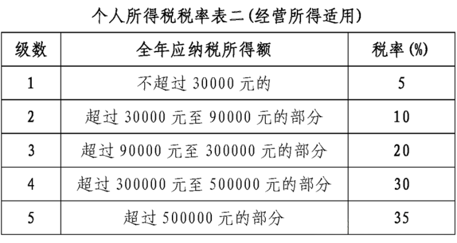
    >
    > **个人所得税税率表二（经营所得适用）**
    >
    > 级数 | 全年应纳税所得额 | 税率（%）
    > :--: | :--: | :--:
    > 1 | 不超过30000元的 | 5
    > 2 | 超过30000元至90000元的部分 | 10
    >
    > 续表
    >
    > 级数 | 全年应纳税所得额 | 税率（%）
    > :--: | :--: | :--:
    > 3 | 超过90000元至300000元的部分 | 20
    > 4 | 超过300000元至500000元的部分 | 30
    > 5 | 超过500000元的部分 | 35
    >
    > （注：本表所称全年应纳税所得额是指依照本法第六条的规定，以每一纳税年度的收入总额减除成本、费用以及损失后的余额。）

    > **示例4：** 《中华人民共和国关税法》附件
    >
    > 附：中华人民共和国进出口税则（注：《中华人民共和国进出口税则》由国务院关税税则委员会发布）

### 14. 近似字词选用

#### 14.1 按照、参照、依照

- **14.1.1** “按照”一般用于对约定、章程、规定、份额、比例等的表述。

    > **示例：** 投保人可以按照合同约定向保险人一次支付全部保险费或者分期支付保险费。（《中华人民共和国保险法》第三十五条）

- **14.1.2** 法律规定的事项或者制度高度类同时，可以使用“参照”以简化对某一事项或者制度的规定。

    > **示例：** 证据保全的其他程序，参照适用本法第九章保全的有关规定。（《中华人民共和国民事诉讼法》第八十四条第三款）

- **14.1.3** 在表述以法律法规作为依据时，使用“依照”；在表述以法规规章等规定作为依据时，使用“按照”。

    > **示例1：** 国务院和地方人民政府依照法律、行政法规的规定，分别代表国家对国家出资企业履行出资人职责，享有出资人权益。（《中华人民共和国企业国有资产法》第四条第一款）

    > **示例2：** 履行出资人职责的机构应当按照国家有关规定，定期向本级人民政府报告有关国有资产总量、结构、变动、收益等汇总分析的情况。（《中华人民共和国企业国有资产法》第十五条第二款）

#### 14.2 根据、依据

- **14.2.1** 引用宪法、法律作为立法根据时，用“根据”。

    > **示例：** 为了加强国防建设，完善国防动员制度，保障国防动员工作的顺利进行，维护国家的主权、统一、领土完整和安全，根据宪法，制定本法。（《中华人民共和国国防动员法》第一条）

- **14.2.2** 表述依据法律的具体条款或者规定作出决定或者从事某项活动时，用“依据”。

    > **示例：** 对反垄断执法机构依据本法第二十八条、第二十九条作出的决定不服的，可以先依法申请行政复议；对行政复议决定不服的，可以依法提起行政诉讼。（《中华人民共和国反垄断法》第五十三条第一款）

#### 14.3 撤销、吊销、撤回、注销

- **14.3.1** 行政机关作出准予行政许可的决定违法，或者被许可人以欺骗、贿赂等不正当手段取得行政许可，依法取消该行政许可的，用“撤销”。

    > **示例1：** 城乡规划主管部门违反本法规定作出行政许可的，上级人民政府城乡规划主管部门有权责令其撤销或者直接撤销该行政许可。因撤销行政许可给当事人合法权益造成损失的，应当依法给予赔偿。（《中华人民共和国城乡规划法》第五十七条）

    > **示例2：** 以欺骗、贿赂等不正当手段为中国籍船舶取得相关证书、文书的，由海事管理机构撤销有关许可，没收相关证书、文书，对船舶所有人、经营人或者管理人处四万元以上四十万元以下的罚款。（《中华人民共和国海上交通安全法》第九十八条第一款）

- **14.3.2** 行政机关作出准予行政许可的决定，但是被许可人在取得行政许可后有违法行为或者不再符合行政许可条件的，依法取消该行政许可的，用“吊销”。吊销行政许可是一种行政处罚。

    > **示例1：** 邮政企业、快递企业不建立或者不执行收件验视制度，或者违反法律、行政法规以及国务院和国务院有关部门关于禁止寄递或者限制寄递物品的规定收寄邮件、快件的，对邮政企业直接负责的主管人员和其他直接责任人员给予处分；对快递企业，邮政管理部门可以责令停业整顿直至吊销其快递业务经营许可证。（《中华人民共和国邮政法》第七十五条第一款）

    > **示例2：** 城乡规划编制单位取得资质证书后，不再符合相应的资质条件的，由原发证机关责令限期改正；逾期不改正的，降低资质等级或者吊销资质证书。（《中华人民共和国城乡规划法》第六十三条）

- **14.3.3** 行政机关作出准予行政许可的决定，为公共利益的需要，依法取消该行政许可的，用“撤回”。

    > **示例：** 行政许可所依据的法律、法规、规章修改或者废止，或者准予行政许可所依据的客观情况发生重大变化的，为了公共利益的需要，行政机关可以依法变更或者撤回已经生效的行政许可。由此给公民、法人或者其他组织造成财产损失的，行政机关应当依法给予补偿。（《中华人民共和国行政许可法》第八条第二款）

- **14.3.4** 行政许可被撤销、吊销、撤回，或者市场主体等解散后，消除行政许可证件或者登记事项的，用“注销”。

    > **示例：** 公司因解散、被宣告破产或者其他法定事由需要终止的，应当依法向公司登记机关申请注销登记，由公司登记机关公告公司终止。（《中华人民共和国公司法》第三十七条）

#### 14.4 从业人员、执业人员

- **14.4.1** “从业人员”用于表述在一般性行业就业的人员。

    > **示例：** 无雇工的个体工商户、未在用人单位参加基本养老保险的非全日制从业人员以及其他灵活就业人员可以参加基本养老保险，由个人缴纳基本养老保险费。（《中华人民共和国社会保险法》第十条第二款）

- **14.4.2** “执业人员”用于表述依法取得相应执业证书并从业的人员。

    > **示例：** 本法所称律师，是指依法取得律师执业证书，接受委托或者指定，为当事人提供法律服务的执业人员。（《中华人民共和国律师法》第二条）

#### 14.5 抵消、抵销

- **14.5.1** “抵消”用于表述两种事物的作用因相反而互相消除。

- **14.5.2** “抵销”用于表述账的冲抵。法律中表述债权债务相互冲销抵免时，用“抵销”，不用“抵消”。

    > **示例：** 合伙人发生与合伙企业无关的债务，相关债权人不得以其债权抵销其对合伙企业的债务；也不得代位行使合伙人在合伙企业中的权利。（《中华人民共和国合伙企业法》第四十一条）

#### 14.6 发布、公布、公告

- **14.6.1** “发布”用于对外发出新闻、信息、命令、指示等，通常强调发布者的权力或者义务。

    > **示例：** 国务院发布的行政法规、决定、命令，向全国人民代表大会或者全国人民代表大会常务委员会提出的议案，任免人员，由总理签署。（《中华人民共和国国务院组织法》第九条）

- **14.6.2** “公布”用于通过一定的程序、方式公开发布法律、法规、规章、结果、标准等。

    > **示例1：** 本法自公布之日起施行。（《中华人民共和国村民委员会组织法》第四十一条）

    > **示例2：** 食品安全国家标准由国务院卫生行政部门会同国务院食品药品监督管理部门制定、公布，国务院标准化行政部门提供国家标准编号。（《中华人民共和国食品安全法》第二十七条第一款）

- **14.6.3** “公告”用于向公众发出提示事项。

    > **示例：** 公安机关交通管理部门根据道路和交通流量的具体情况，可以对机动车、非机动车、行人采取疏导、限制通行、禁止通行等措施。遇有大型群众性活动、大范围施工等情况，需要采取限制交通的措施，或者作出与公众的道路交通活动直接有关的决定，应当提前向社会公告。（《中华人民共和国道路交通安全法》第三十九条）

#### 14.7 非法、违法

- **14.7.1** “非法”、“违法”都是指行为不合法。“非法”强调行为缺乏法律依据；“违法”在法律中使用更为广泛，表示行为违反法律的强制性规范。

    > **示例1：** 义务教育经费严格按照预算规定用于义务教育；任何组织和个人不得侵占、挪用义务教育经费，不得向学校非法收取或者摊派费用。（《中华人民共和国义务教育法》第四十九条）

    > **示例2：** 被检查单位或者个人拒不停止违法行为，造成严重水土流失的，报经水行政主管部门批准，可以查封、扣押实施违法行为的工具及施工机械、设备等。（《中华人民共和国水土保持法》第四十四条第二款）

#### 14.8 规定、制定

- **14.8.1** 表述就具体事项作出决定时，用“规定”。

    > **示例：** 野生动物迁徙洄游期间，在前款规定区域外的迁徙洄游通道内，禁止猎捕并严格限制其他妨碍野生动物生息繁衍的活动。迁徙洄游通道的范围以及妨碍野生动物生息繁衍活动的内容，由县级以上人民政府或者其野生动物保护主管部门规定并公布。（《中华人民共和国野生动物保护法》第二十条第二款）

- **14.8.2** 表述创设法律、法规等规范性文件时，用“制定”。

    > **示例：** 省、自治区、直辖市的人民代表大会及其常务委员会根据本行政区域的具体情况和实际需要，在不同宪法、法律、行政法规相抵触的前提下，可以制定地方性法规。（《中华人民共和国立法法》第八十条）

#### 14.9 拟订、拟定

- **14.9.1** “拟订”、“拟定”都用于文件的草拟。“拟订”侧重于过程，“拟定”侧重于结果。

    > **示例1：** 常务委员会工作机构研究拟订法律解释草案，由委员长会议决定列入常务委员会会议议程。（《中华人民共和国立法法》第五十条）

    > **示例2：** 中华人民共和国国界线的测绘，按照中华人民共和国与相邻国家缔结的边界条约或者协定执行，由外交部组织实施。中华人民共和国地图的国界线标准样图，由外交部和国务院测绘地理信息主管部门拟定，报国务院批准后公布。（《中华人民共和国测绘法》第二十条）

#### 14.10 作出、做出

- **14.10.1** 法律中多使用“作出”，与决定、解释等词语搭配使用。

    > **示例：** 依据本法第十一条、第十二条、第十八条、第二十二条和前款规定，对涉诈异常情形采取限制、暂停服务等处置措施的，应当告知处置原因、救济渠道及需要提交的资料等事项，被处置对象可以向作出决定或者采取措施的部门、单位提出申诉。作出决定的部门、单位应当建立完善申诉渠道，及时受理申诉并核查，核查通过的，应当即时解除有关措施。（《中华人民共和国反电信网络诈骗法》第三十二条第三款）

- **14.10.2** “做出”通常与成绩、贡献搭配使用。

    > **示例：** 对在军人地位和权益保障工作中做出突出贡献的单位和个人，按照国家有关规定给予表彰、奖励。（《中华人民共和国军人地位和权益保障法》第十一条）

#### 14.11 会同、商

- **14.11.1** “会同”、“商”都用于一方主体与其他主体达成一致后，制定文件或者作出决定。“会同”强调共同制定、发布文件或者作出决定；“商”强调由发起主体单独制定、发布文件或者作出决定。协商的主体为不同层级的主体时，一般用“商”。

    > **示例1：** 国务院证券监督管理机构认为有必要时，可以委托会计师事务所、资产评估机构对证券公司的财务状况、内部控制状况、资产价值进行审计或者评估。具体办法由国务院证券监督管理机构会同有关主管部门制定。（《中华人民共和国证券法》第一百三十九条）

    > **示例2：** 对航行国际航线的船舶开放的港口，由有关省、自治区、直辖市人民政府按照国家有关规定商国务院有关部门和有关军事机关同意后，报国务院批准。（《中华人民共和国港口法》第五十九条）

#### 14.12 交纳、缴纳

- **14.12.1** 表述当事人向法定机关交付款项时，一般用“交纳”；表述强制性交付时，用“缴纳”。

    > **示例1：** 当事人进行民事诉讼，应当按照规定交纳案件受理费。财产案件除交纳案件受理费外，并按照规定交纳其他诉讼费用。（《中华人民共和国民事诉讼法》第一百二十一条第一款）

    > **示例2：** 在中华人民共和国境内书立应税凭证、进行证券交易的单位和个人，为印花税的纳税人，应当依照本法规定缴纳印花税。在中华人民共和国境外书立在境内使用的应税凭证的单位和个人，应当依照本法规定缴纳印花税。（《中华人民共和国印花税法》第一条）

#### 14.13 期间、期限

- **14.13.1** “期间”是指某段时期内。

    > **示例：** 修复施工期间，应当设立公告牌，公开相关情况和环境保护措施。（《中华人民共和国土壤污染防治法》第四十条第三款）

- **14.13.2** “期限”是指限定的一段时间，或者所限时间的最后界限。

    > **示例：** 外国国家对中华人民共和国的法院缺席判决提起上诉的期限为六个月，从判决书送达之日起计算。（《中华人民共和国外国国家豁免法》第十八条第三款）

#### 14.14 设定、设立

- **14.14.1** “设定”和“设立”都可以用于权利、义务、条件等的设置。

    > **示例1：** 设定和实施行政处罚必须以事实为依据，与违法行为的事实、性质、情节以及社会危害程度相当。（《中华人民共和国行政处罚法》第五条第二款）

    > **示例2：** 不动产物权的设立、变更、转让和消灭，应当依照法律规定登记。动产物权的设立和转让，应当依照法律规定交付。（《中华人民共和国民法典》第二百零八条）

- **14.14.2** “设立”还可以用于组织、机构、项目等的开办或者成立。

    > **示例1：** 国务院设立学位委员会，领导全国学位工作。（《中华人民共和国学位法》第六条第一款）

    > **示例2：** 国务院和县级以上地方人民政府根据实际需要，设立专项资金，扶持农村地区、民族地区实施义务教育。（《中华人民共和国义务教育法》第四十七条）

#### 14.15 应当、必须

- **14.15.1** 法律使用“应当”、“必须”表述义务性规范时，含义没有实质区别，但一般用“应当”，不用“必须”。

    > **示例：** 国家工作人员应当带头树立良好家风，履行家庭教育责任。（《中华人民共和国家庭教育促进法》第四条第三款）

#### 14.16 不得、禁止

- **14.16.1** “不得”、“禁止”都用于表述禁止性规范。“不得”一般用于有主语或者有明确的被规范对象的句子中，“禁止”一般用于无主语的祈使句中。

    > **示例1：** 任何单位和个人不得违反有关环境保护法律、法规的规定向农产品产地排放或者倾倒废水、废气、固体废物或者其他有毒有害物质。（《中华人民共和国农产品质量安全法》第二十二条第一款）

    > **示例2：** 禁止或者限制在自然保护地内引入外来物种、营造单一纯林、过量施洒农药等人为干扰、威胁野生动物生息繁衍的行为。（《中华人民共和国野生动物保护法》第十二条第三款）

#### 14.17 账、帐

- **14.17.1** 表述货币、货物出入的记载、账簿或者债务时，用“账”，不用“帐”。

    > **示例：** 保险代理机构、保险经纪人应当有自己的经营场所，设立专门账簿记载保险代理业务、经纪业务的收支情况。（《中华人民共和国保险法》第一百二十三条）

#### 14.18 通信、通讯

- **14.18.1** “通信”是指通过传统书信或者电子信息技术传送信息。

    > **示例：** 辩护律师可以同在押的犯罪嫌疑人、被告人会见和通信。其他辩护人经人民法院、人民检察院许可，也可以同在押的犯罪嫌疑人、被告人会见和通信。（《中华人民共和国刑事诉讼法》第三十九条第一款）

- **14.18.2** “通讯”是“通信”的旧称，现在仅指一种新闻报道文体。

    > **示例：** （二）报社、期刊社、通讯社、广播电台、电视台的工作人员创作的职务作品；（《中华人民共和国著作权法》第十八条第二款第二项）

#### 14.19 改正、纠正

- **14.19.1** 表述自己改正错误，用“改正”。

    > **示例：** 被拘留的人，由人民法院交公安机关看管。在拘留期间，被拘留人承认并改正错误的，人民法院可以决定提前解除拘留。（《中华人民共和国民事诉讼法》第一百一十八条第三款）

- **14.19.2** 表述国家机关等纠正他人错误，用“纠正”。

    > **示例：** 各级人民政府和有关部门应当完善就业保障政策措施，防止和纠正就业性别歧视，为妇女创造公平的就业创业环境，为就业困难的妇女提供必要的扶持和援助。（《中华人民共和国妇女权益保障法》第四十二条）

#### 14.20 收集、搜集

- **14.20.1** “收集”、“搜集”都是指查找并获取资料、信息等。“收集”多与一般主体搭配，“搜集”多与国家机关搭配。

    > **示例1：** 代理诉讼的律师和其他诉讼代理人有权调查收集证据，可以查阅本案有关材料。查阅本案有关材料的范围和办法由最高人民法院规定。（《中华人民共和国民事诉讼法》第六十四条）

    > **示例2：** 国家安全机关、公安机关依法搜集涉及国家安全的情报信息，在国家安全工作中依法行使侦查、拘留、预审和执行逮捕以及法律规定的其他职权。（《中华人民共和国国家安全法》第四十二条第一款）

#### 14.21 二、两

- **14.21.1** 法律中表示数量，特别是涉及时限、金额时，一般用“二”；按照语言习惯偏口语时，也可以用“两”。

    > **示例1：** 自然人下落不明满二年的，利害关系人可以向人民法院申请宣告该自然人为失踪人。（《中华人民共和国民法典》第四十条）

    > **示例2：** （二）分别属于村内两个以上农民集体所有的，由村内各该集体经济组织或者村民小组依法代表集体行使所有权；（《中华人民共和国民法典》第二百六十二条第二项）

#### 14.22 零、〇

- **14.22.1** “0”的汉字书写形式有“零”和“〇”两种。法律条文序号中，“0”写作“零”；主席令编号中，“0”写作“〇”。

    > **示例1：** 第一百零一条、第一千二百零九条

    > **示例2：** 第一〇八号、第一二〇号

#### 14.23 标志、标识

- **14.23.1** “标志”、“标识（shí）”均是指用于表现或者识别事物的文字、图形等符号。直观表现事物的特征或者识别抽象事物的符号，一般用“标志”。需要通过载记内容进一步识别事物的符号，用“标识”。

    > **示例1：** 特种设备出厂时，应当随附安全技术规范要求的设计文件、产品质量合格证明、安装及使用维护保养说明、监督检验证明等相关技术资料和文件，并在特种设备显著位置设置产品铭牌、安全警示标志及其说明。（《中华人民共和国特种设备安全法》第二十一条）

    > **示例2：** 中华人民共和国国徽是中华人民共和国的象征和标志。（《中华人民共和国国徽法》第三条第一款）

    > **示例3：** 农产品生产企业、农民专业合作社以及从事农产品收购的单位或者个人销售的农产品，按照规定应当包装或者附加承诺达标合格证等标识的，须经包装或者附加标识后方可销售。包装物或者标识上应当按照规定标明产品的品名、产地、生产者、生产日期、保质期、产品质量等级等内容；使用添加剂的，还应当按照规定标明添加剂的名称。具体办法由国务院农业农村主管部门制定。（《中华人民共和国农产品质量安全法》第三十八条）

#### 14.24 缔结、参加、共同参加

- **14.24.1** 表述作为创始国身份加入条约或者协定，用“缔结”。

- **14.24.2** 表述加入已缔结的条约或者协定，用“参加”。

    > **示例：** 国家依照宪法和法律缔结或者参加条约和协定，善意履行有关条约和协定规定的义务。（《中华人民共和国对外关系法》第三十条第一款）

- **14.24.3** 基于对等原则，强调我国与相关国家或者地区按照都已加入的条约或者协定行事，用“共同参加”。

    > **示例：** 本法所称刑事司法协助条约，是指中华人民共和国与外国缔结或者共同参加的刑事司法协助条约、移管被判刑人条约或者载有刑事司法协助、移管被判刑人条款的其他条约。（《中华人民共和国国际刑事司法协助法》第六十九条）

---

## 全国人大常委会审议法律草案有关文件参考格式

**说明：**

一、本部分所列文件参考格式，以全国人大常委会会议三次审议通过法律案的相关正式文件为例，包括关于提请全国人大常委会审议法律案的议案、关于法律草案的说明、法律草案，全国人大宪法和法律委员会关于法律草案修改情况的汇报、法律草案二次审议稿，全国人大宪法和法律委员会关于法律草案审议结果的报告、法律草案三次审议稿，全国人大宪法和法律委员会关于法律草案修改意见的报告、法律草案修改稿和表决稿，中华人民共和国主席令、法律文本。

二、本部分所列文件参考格式，以全国人大常委会委员长会议提请全国人大常委会会议审议法律案为例。其他有权主体提请审议法律案议案及草案说明文本的不同之处，在有关参考格式后予以标注说明。

三、本部分所列文件参考格式，以制定法律和修改法律的文件为例，解释法律、废止法律、作出有关法律问题的决定、清理法律等相关文件参照适用。

### 1. 初次审议

#### 1.1 议案

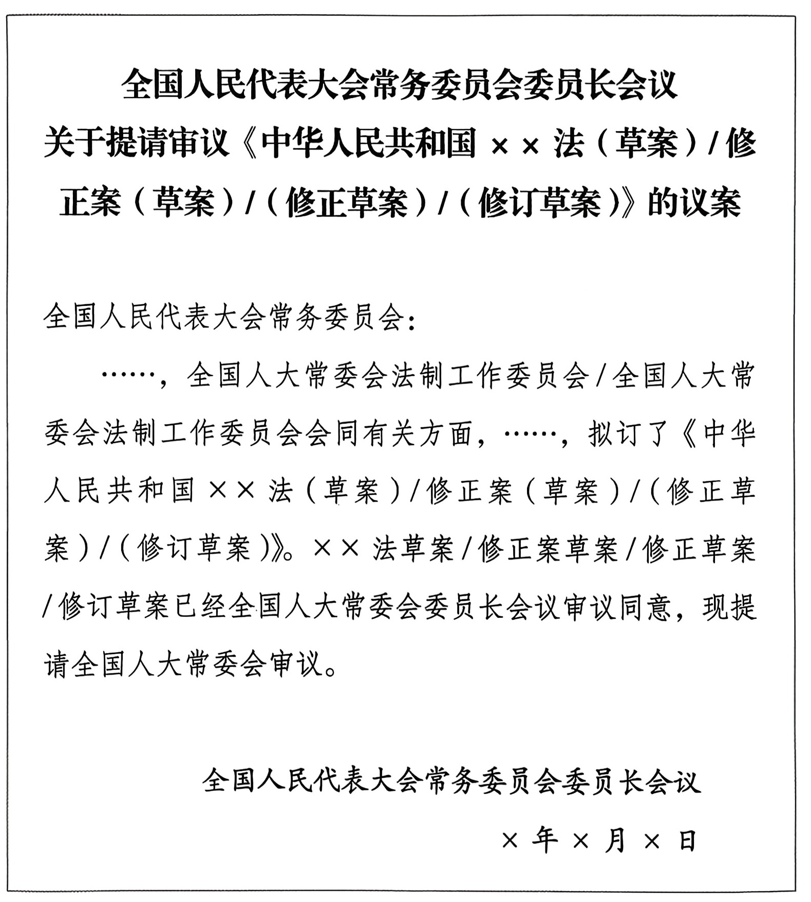

```
　　全国人民代表大会常务委员会委员长会议
　关于提请审议《中华人民共和国××法（草案）/修
正案（草案）/（修正草案）/（修订草案）》的议案

全国人民代表大会常务委员会：

　　……，全国人大常委会法制工作委员会/全国人大常
委会法制工作委员会会同有关方面，……，拟订了《中华
人民共和国××法（草案）/修正案（草案）/（修正草
案）/（修订草案）》。××法草案/修正案草案/修正草案
/修订草案已经全目人大常委会委员长会议审议同意，现提
请全国人大常委会审议。

　　　　　　　全国人民代表大会常务委员会委员长会议
　　　　　　　　　　　　　　　　　　　　×年×月×日
```

> **注：** 由国务院、中央军事委员会、国家监察委员会、最高人民法院、最高人民检察院提出的议案，落款为国务院总理、中央军事委员会主席、国家监察委员会主任、最高人民法院院长、最高人民检察院检察长并签名。全国人民代表大会各专门委员会提出的议案，落款为全国人民代表大会××委员会

#### 1.2 法律草案的说明

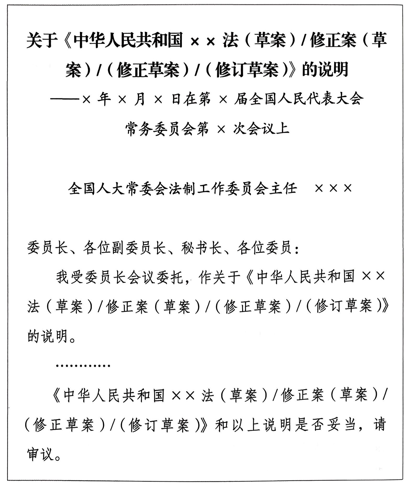

```
　关于《中华人民共和国××法（草案）/修正案（草
　　案）/（修正草案）/（修订草案））的说明

　　　——×年×月×日在第×届全国人民代表大会
　　　　　常务委员会第×次会议上

全国人大常委会法制工作委员会主任　×××

委员长、各位副委员长、秘书长、各位委员：
　　我受委员长会议委托，作关于《中华人民共和国××
法（草案）/修正案（草案）/（修正草案）/（修订草案）》
的说明。
　　…………
　　《中华人民共和国××法（草案）/修正案（草案）/
（修正草案）/（修订草案）》和以上说明是否妥当，请审议。
```

> **注：** 说明人为提案单位的负责同志或者提案单位委托的有关负责同志

#### 1.3 法律草案

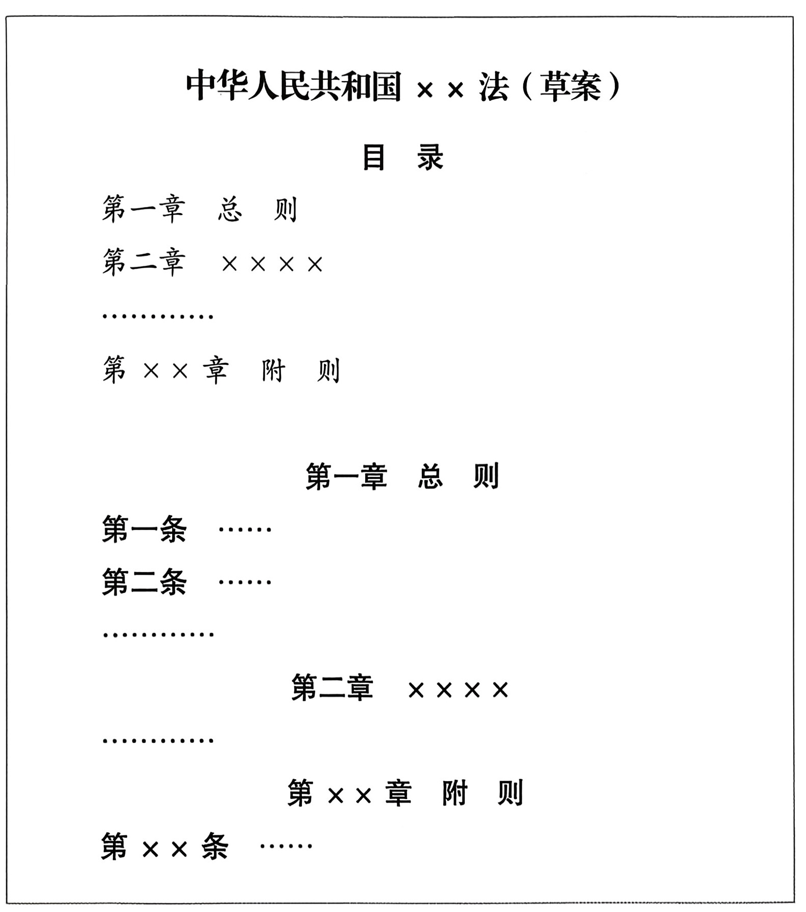

```
　　中华人民共和国××法（草案）

　　　目　　录
第一章　总　则
第二章　××××
…………
第××章　附　则

　　　第一章　总　则

第一条　……
第二条　……
…………

　　　第二章　××××

…………

　　　第××章　附　则

第××条　……
```

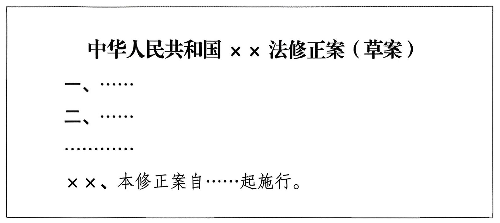

```
　　中华人民共和国××法修正案（草案）

一、……
二、……
…………
××、本修正案自……起施行。
```

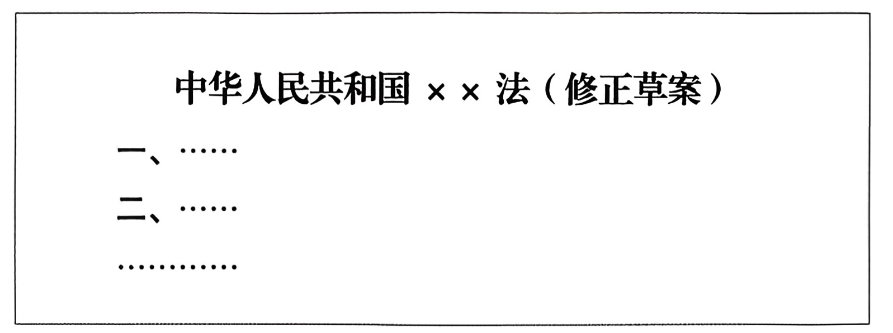

```
　　中华人民共和国××法（修正草案）

一、……
二、……
…………
```

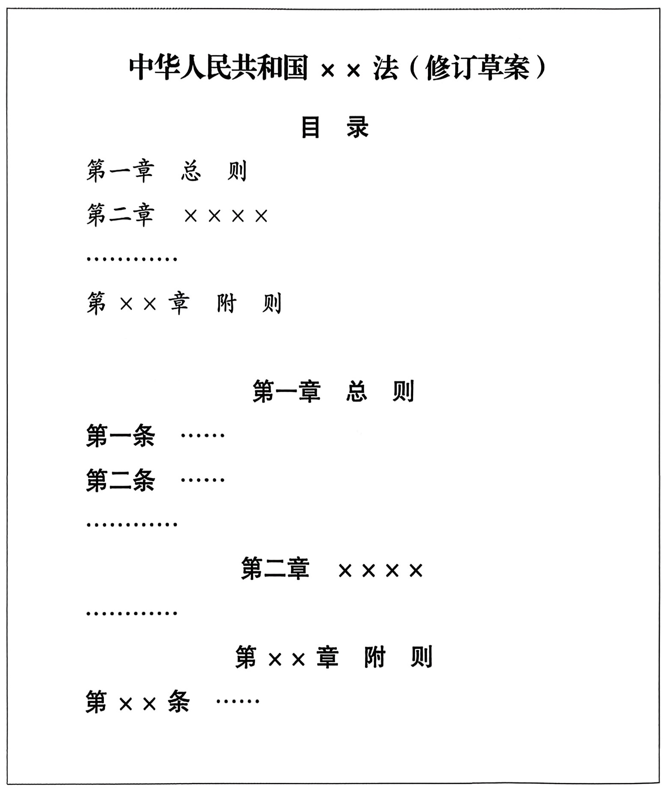

```
　　中华人民共和国××法（修订草案）

　　　目　　录
第一章　总　则
第二章　××××
…………
第××章　附　则

　　　第一章　总　则

第一条　……
第二条　……
…………

　　　第二章　××××

…………

　　　第××章　附　则

第××条　……
```

> **注：** ××法修正案（草案）、××法（修正草案）、××法（修订草案）附修改前后对照表

### 2. 第二次审议

#### 2.1 修改情况的汇报

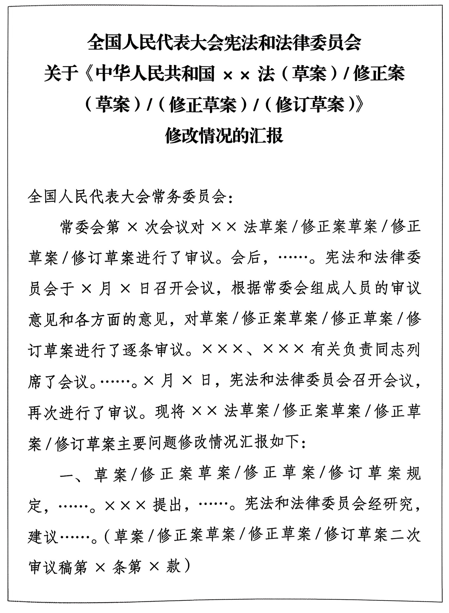
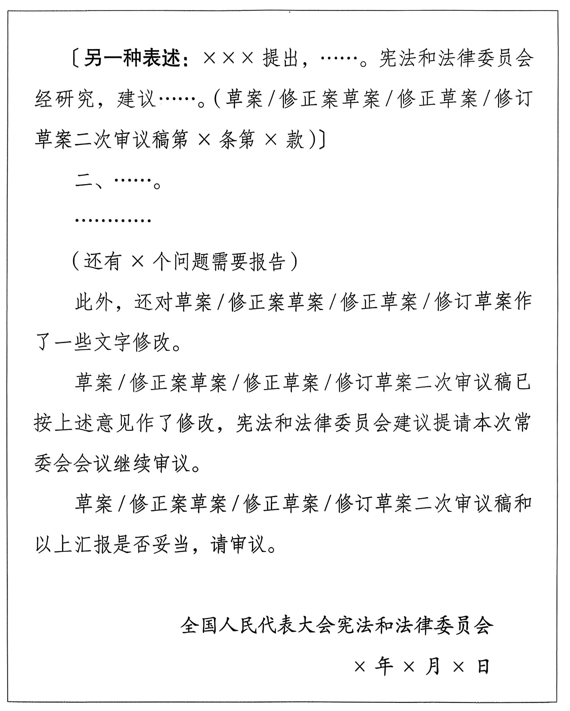

```
　　全国人民代表大会宪法和法律委员会
　关于《中华人民共和国××法（草案）/修正案
　（草案）/（修正草案）/（修订草案））
　　　　　修改情况的汇报

全国人民代表大会常务委员会：
　　常委会第×次会议对××法草案/修正案草案/修正
草案/修订草案进行了审议。会后，……。宪法和法律委
员会于×月×日召开会议，根据常委会组成人员的审议
意见和各方面的意见，对草案/修正案草案/修正草案/修
订草案进行了逐条审议。×××、×××有关负责同志列
席了会议。……。×月×日，宪法和法律委员会召开会议，
再次进行了审议。现将××法草案/修正案草案/修正草
案/修订草案主要问题修改情况汇报如下：
　　一、草案/修正案草案/修正草案/修订草案规
定，……。×××提出，……。宪法和法律委员会经研究，
建议……。（草案/修正案草案/修正草案/修订草案二次
审议稿第×条第×款）
　　〔另一种表述：×××提出，……。宪法和法律委员会
经研究，建议……。（草案/修正案草案/修正草案/修订
草案二次审议稿第×条第×款）〕
　　二、……。

　　（还有×个问题需要报告）
　　此外，还对草案/修正案草案/修正草案/修订草案作
了一些文字修改。
　　草案/修正案草案/修正草案/修订草案二次审议稿已
按上述意见作了修政，宪法和法律委员会建议提请本次常
委会会议继续审议。
　　草案/修正案草案/修正草案/修订草案二次审议稿和
以上汇报是否妥当，请审议。

　　　　　　　　　　　全国人民代表大会宪法和法律委员会
　　　　　　　　　　　　　　　　　　　　　　×年×月×日
```

#### 2.2 法律草案

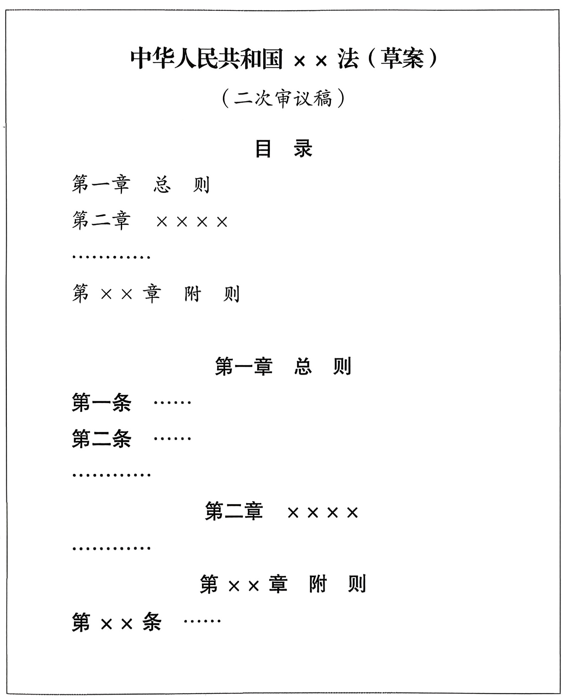

```
　　中华人民共和国××法（草案）
　　　　（二次审议稿）

　　　　目　　录

第一章　总　则
第二章　××××
…………
第××章　附　则

　　　　第一章　总　则
第一条　……
第二条　……
…………

　　　　第二章　××××

…………

　　　　第××章　附则

第××条　……
```

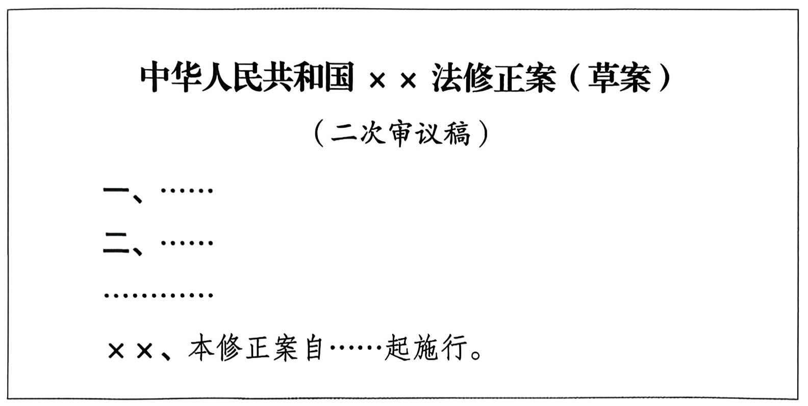

```
　　中华人民共和国××法修正案（草案）
　　　　（二次审议稿）

一、……
二、……
××、本修正案自……起施行。
```

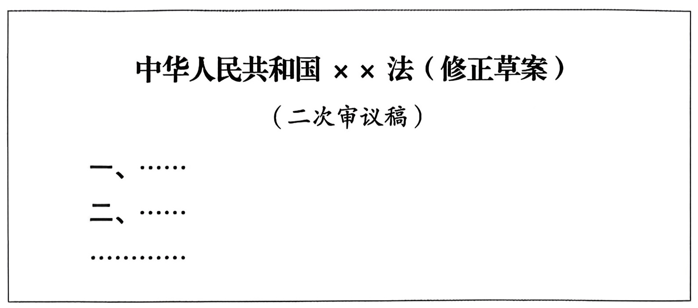

```
　　中华人民共和国××法（修正草案）
　　　　（二次审议稿）

一、……
二、……
…………
```

> **注：** ××法修正案（草案）、××法（修正草案）附修改前后对照表

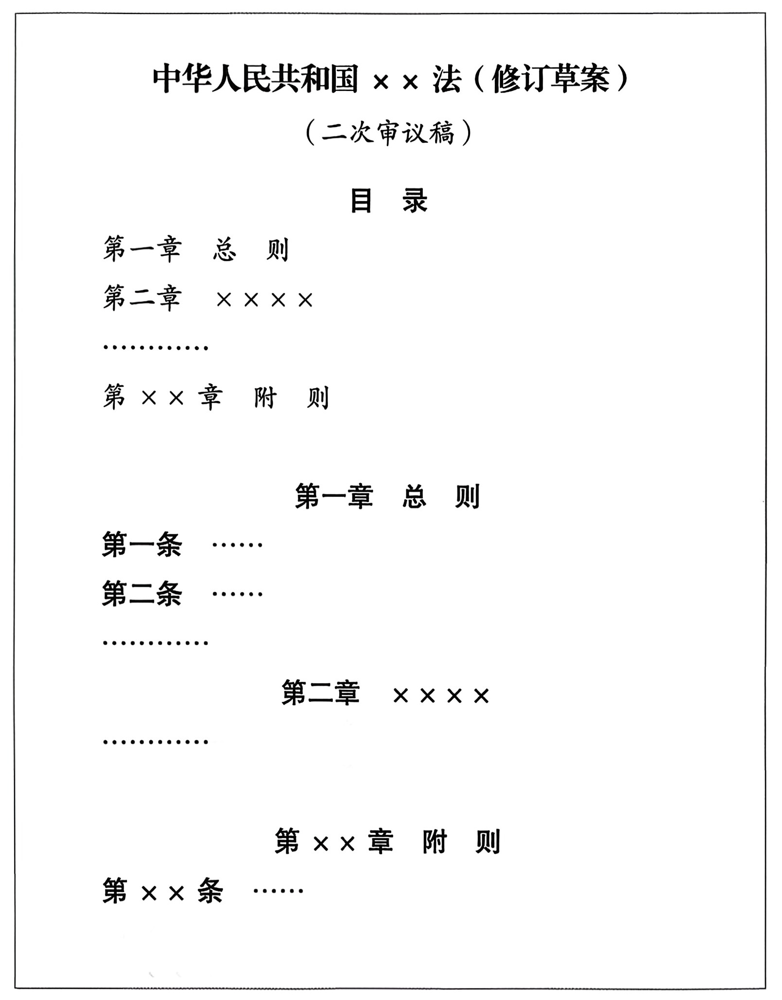

```
　　中华人民共和国××法（修订草案）
　　　　（二次审议稿）

　　　　目　　录

第一章　总　则
第二章　××××
…………
第××章　附　则

　　　　第一章　总　则
第一条　……
第二条　……
…………

　　　　第二章　××××

…………

　　　　第××章　附则

第××条　……
```

### 3. 第三次审议

#### 3.1 审议结果的报告

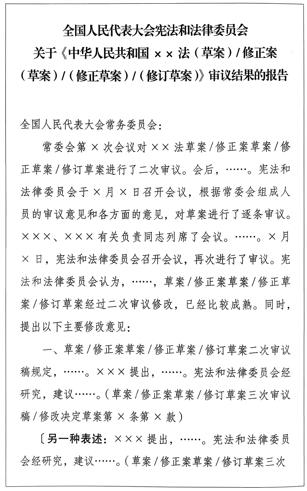
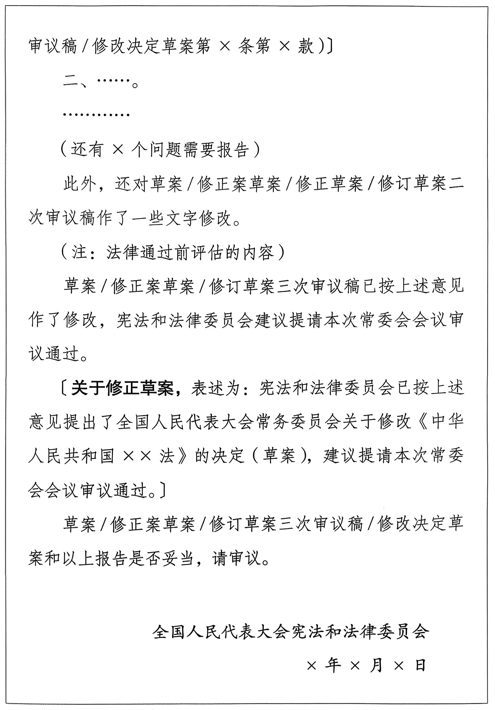

```
　　　　全国人民代表大会宪法和法律委员会
　　关于《中华人民共和国××法（草案）/修正案
（草案）/（修正草案）/（修订草案））审议结果的报告

全国人民代表大会常务委员会：
　　常委会第×次会议对××法草案/修正案草案/修正
草案/修订草案进行了二次审议。会后，……。宪法和
法律委员会于×月×日召开会议，根据常委会组成人
员的审议意见和各方面的意见，对草案进行了逐条审议。
×××、×××有关负责同志列席了会议。……。×月
×日，宪法和法律委员会召开会议，再次进行了审议。宪
法和法律委员会认为，……，草案/修正案草案/修正草
案/修订草案经过二次审议修改，已经比较成熟。同时，
提出以下主要修砍意见：
　　一、草案/修正案草案/修正草案/修订草案二次审议
稿规定，……。×××提出，……。宪法和法律委员会经
研究，建议……。（草案/修正案草案/修订草案三次审议
稿/修敃决定草案第×条第×款）
　　〔另一种表述：×××提出，……。宪法和法律委员
会经研究，建议……。（草案/修正案草案/修订草案三次
审议稿/修改决定草案第×条第×款）〕
　　二、……
　　…………

　　（还有×个问题需要报告）
　　此外，还对草案/修正案草案/修正草案/修订草案二
次审议稿作了一些文字修改。
　　（注：法律通过前评估的内容）
　　草案/修正案草案/修订草案三次审议稿已按上述意见
作了修改，宪法和法律委员会建议提请本次常委会会议审议通过。
　　〔**关于修正草案**，表述为：宪法和法律委员会已按上述
意见提出了全国人民代表大会常务委员会关于修改《中华
人民共和国××法》的决定（草案），建议提请本次常委
会会议审议通过。〕
　　草案/修正案草案/修订草案三次审议稿/修改决定草
案和以上报告是否妥当，请审议。

　　　　　　　　　　全国人民代表大会宪法和法律委员会
　　　　　　　　　　　　　　　　　　　　　×年×月×日
```

#### 3.2 法律草案

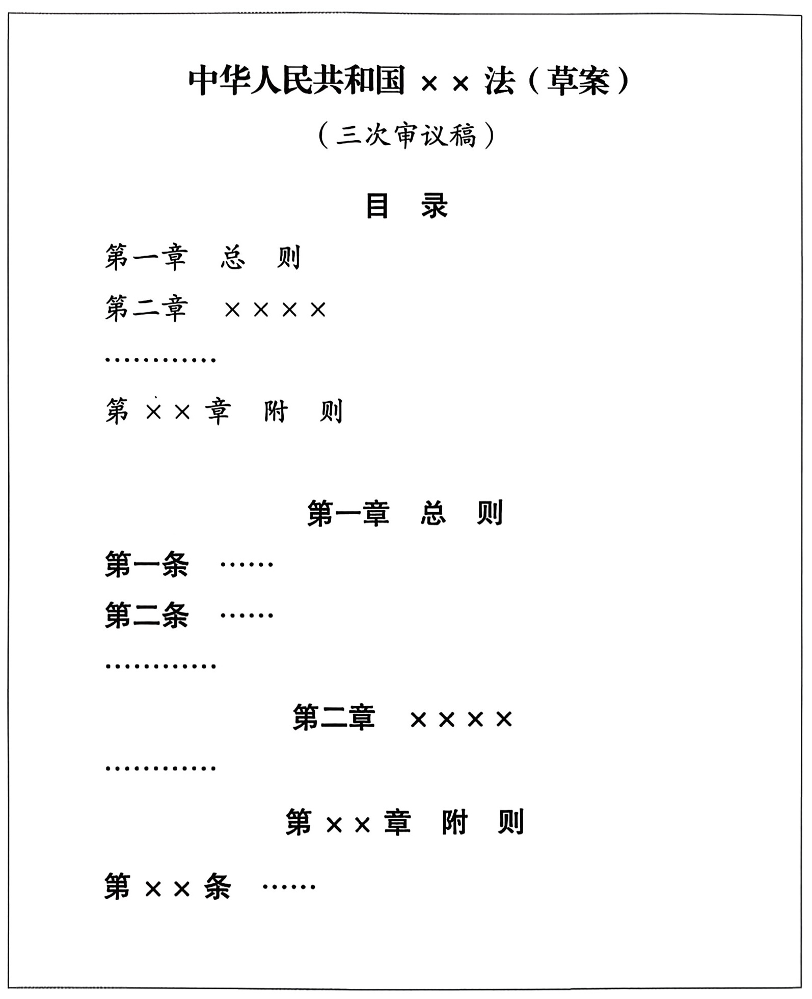

```
　　中华人民共和国××法（草案）
　　　　（三次审议稿）

　　　　目　　录

第一章　总　则
第二章　××××
…………
第××章　附　则

　　　　第一章　总　则
第一条　……
第二条　……
…………

　　　　第二章　××××

…………

　　　　第××章　附则

第××条　……
```

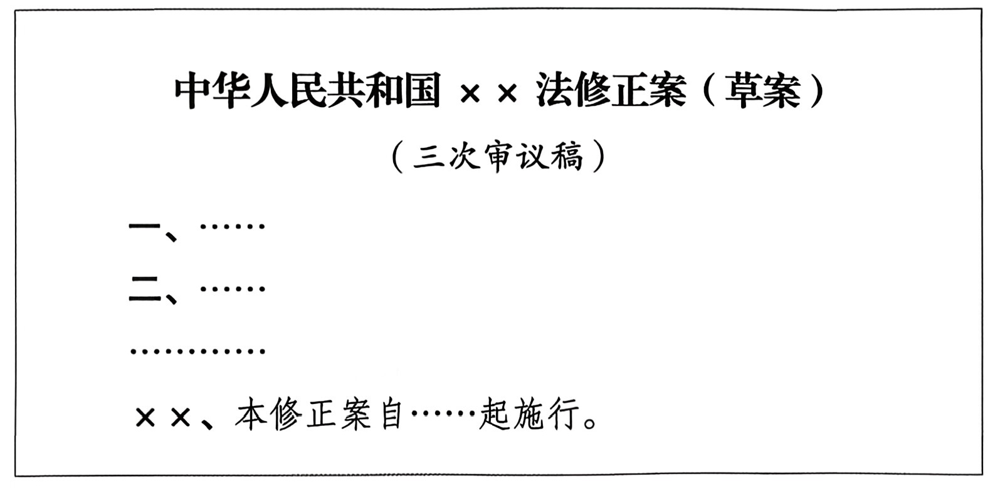

```
　　中华人民共和国××法修正案（草案）
　　　　（三次审议稿）

一、……
二、……
…………
××、本修正案自……起施行。
```

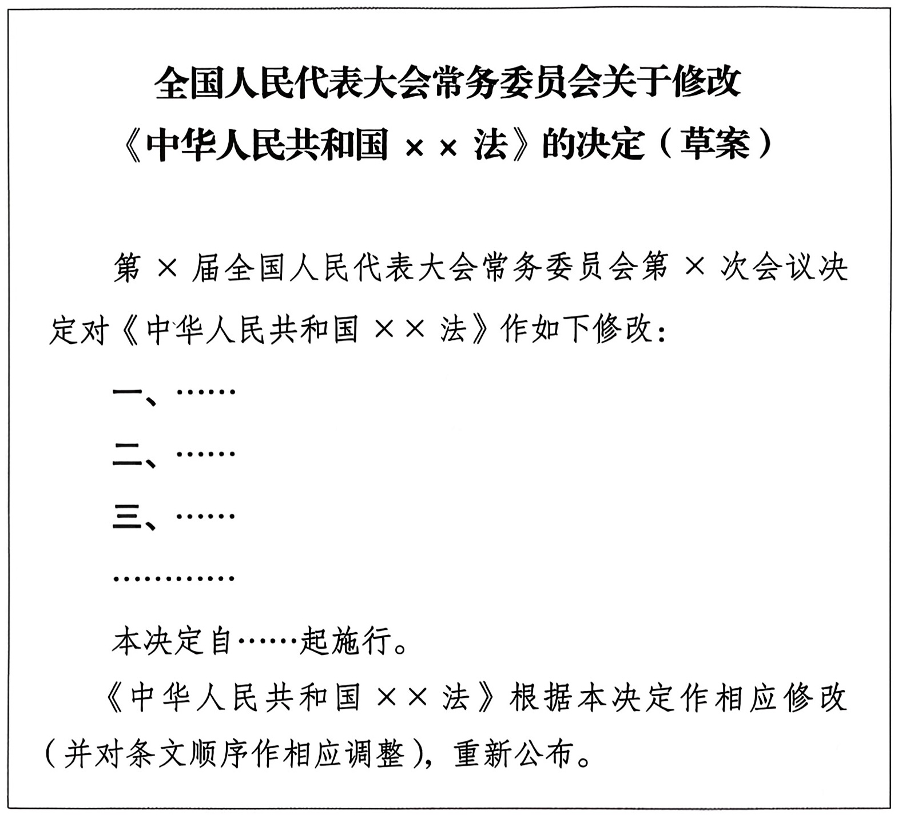

```
　　全国人民代表大会常务委员会关于修改
　《中华人民共和国××法）的决定（草案）

第×届全国人民代表大会常务委员会第×次会议决
定对《中华人民共和国××法》作如下修改：
一、……
二、……
三、……
…………
本决定自……起施行。
《中华人民共和国××法》根据本决定作相应修改
（并对条文顺序作相应调整），重新公布。
```

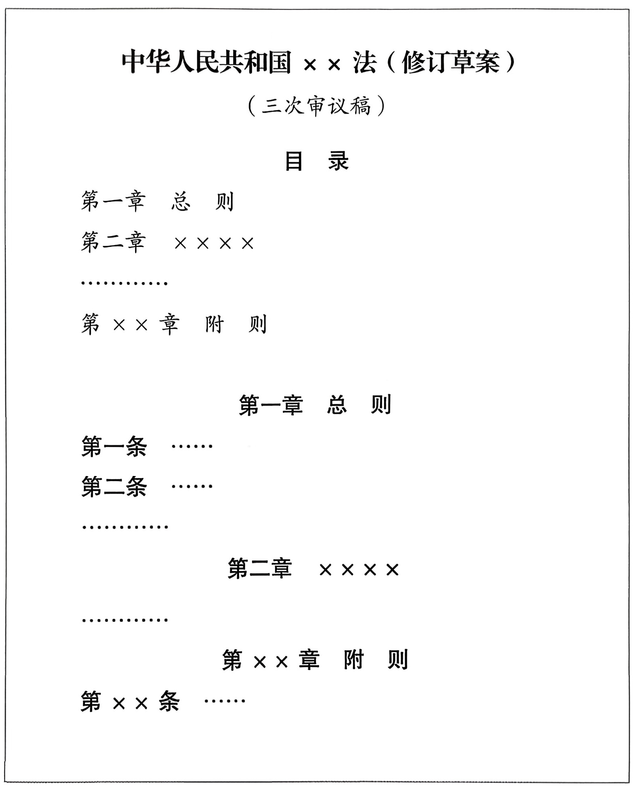

```
　　中华人民共和国××法（修订草案）
　　　　（三次审议稿）

　　　　目　　录

第一章　总　则
第二章　××××
…………
第××章　附　则

　　　　第一章　总　则
第一条　……
第二条　……
…………

　　　　第二章　××××

…………

　　　　第××章　附则

第××条　……
```

#### 3.3 修改意见的报告

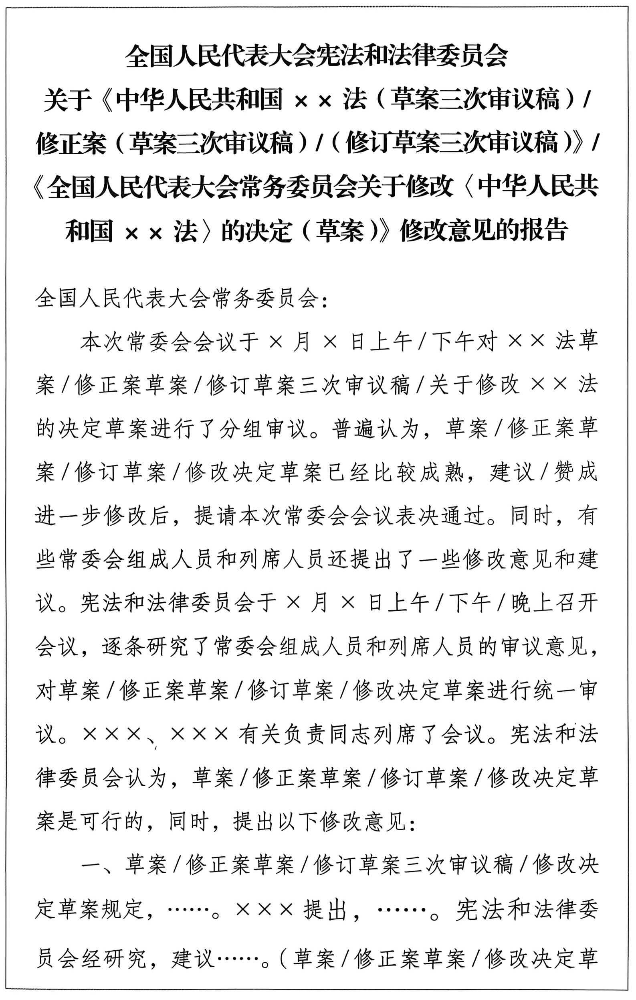
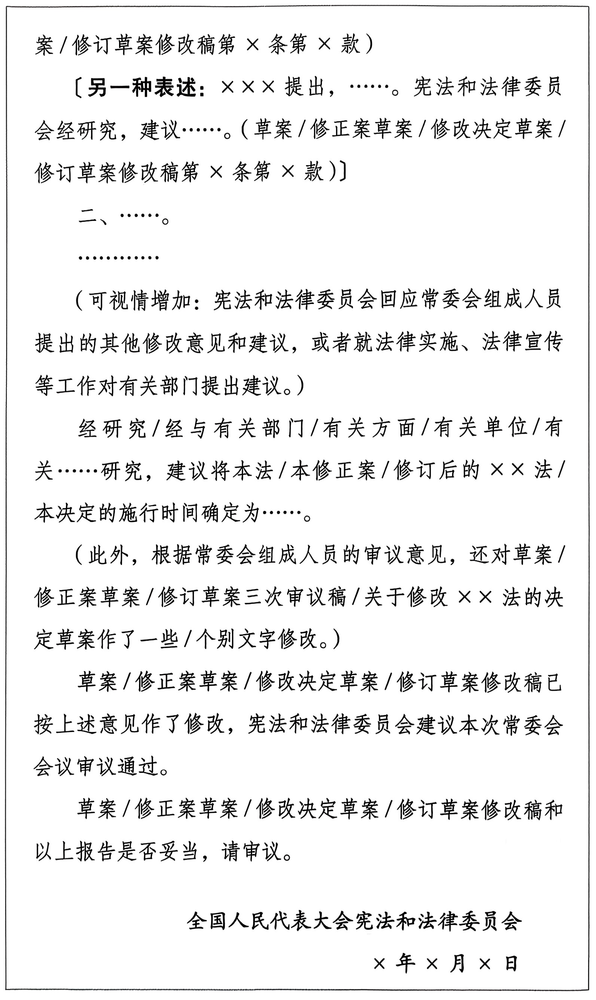

```
　　全国人民代表大会宪法和法律委员会
　关于《中华人民共和国××法（草案三次审议稿）/
修正案（草案三次审议稿）/（修订草案三次审议稿）》/
《全国人民代表大会常务委员会关于修改（中华人民共
　　和国××法〉的决定（草案））修改意见的报告

全国人民代表大会常务委员会：
　　本次常委会会议于×月×日上午/下午对××法草
案/修正案草案/修订草案三次审议稿/关于修改××法
的决定草案进行了分组审议。普遍认为，草案/修正案草
案/修订草案/修改决定草案已经比较成熟，建议/赞成
进一步修改后，提请本次常委会会议表决通过。同时，有
些常委会组成人员和列席人员还提出了一些修改意见和建
议。宪法和法律委员会于×月×日上午/下午/晚上召开
会议，逐条研究了常委会组成人员和列席人员的审议意见，
对草案/修正案草案/修订草案/修改决定草案进行统一审
议。×××、×××有关负责同志列席了会议。宪法和法
律委员会认为，草案/修正案草案/修订草案/修改决定草
案是可行的，同时，提出以下修改意见：
　　一、草案/修正案草案/修订草案三次审议稿/修改
决定草案规定，……。×××提出，……。宪法和法律委
员会经研究，建议……。（草案/修正案草案/修改决定草
案/修订草案修改稿第×条第×款）
　　〔另一种表述：×××提出，……。宪法和法律委员
会经研究，建议……。（草案/修正案草案/修改决定草案/
修订草案修改稿第×条第×款）〕
　　二、……。
　　…………
　　（可视情增加：宪法和法律委员会回应常委会组成人员
提出的其他修改意见和建议，或者就法律实施、法律宣
传等工作对有关部门提出建议。）
　　经研究/经与有关部门/有关方面/有关单位/有
关……研究，建议将本法/本修正案/修订后的××法/
本决定的施行时间确定为……。
　　（此外，根据常委会组成人员的审议意见，还对草案/
修正案草案/修订草案三次审议稿/关于修改××法的决
定草案作了一些/个别文字修改。）
　　草案/修正案草案/修改决定草案/修订草案修改稿已
按上述意见作了修改，宪法和法律委员会建议本次常委会
会议审议通过。
　　草案/修正案草案/修改决定草案/修订草案修改稿和
以上报告是否妥当，请审议。

　　　　　　　　　　全国人民代表大会宪法和法律委员会
　　　　　　　　　　　　　　　　　　　　　×年×月×日
```

#### 3.4 法律草案修改稿

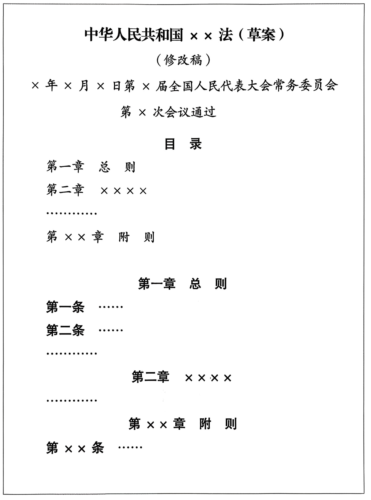

```
　　中华人民共和国××法（草案）
　　　　　（修改稿）

×年×月×日第×届全国人民代表大会常务委员会
　　　　第×次会议通过

　　　　目　　录

第一章　总　则
第二章　××××
…………
第××章　附　则

　　　　第一章　总　则
第一条　……
第二条　……
…………

　　　　第二章　××××

…………

　　　　第××章　附则

第××条　……
```

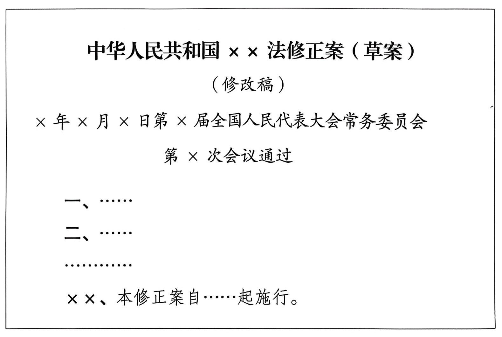

```
　　中华人民共和国××法修正案（草案）
　　　　　　（修改稿）

×年×月×日第×届全国人民代表大会常务委员会
　　　　　第×次会议通过

一、……
二、……
…………
××、本修正案自……起施行。
```

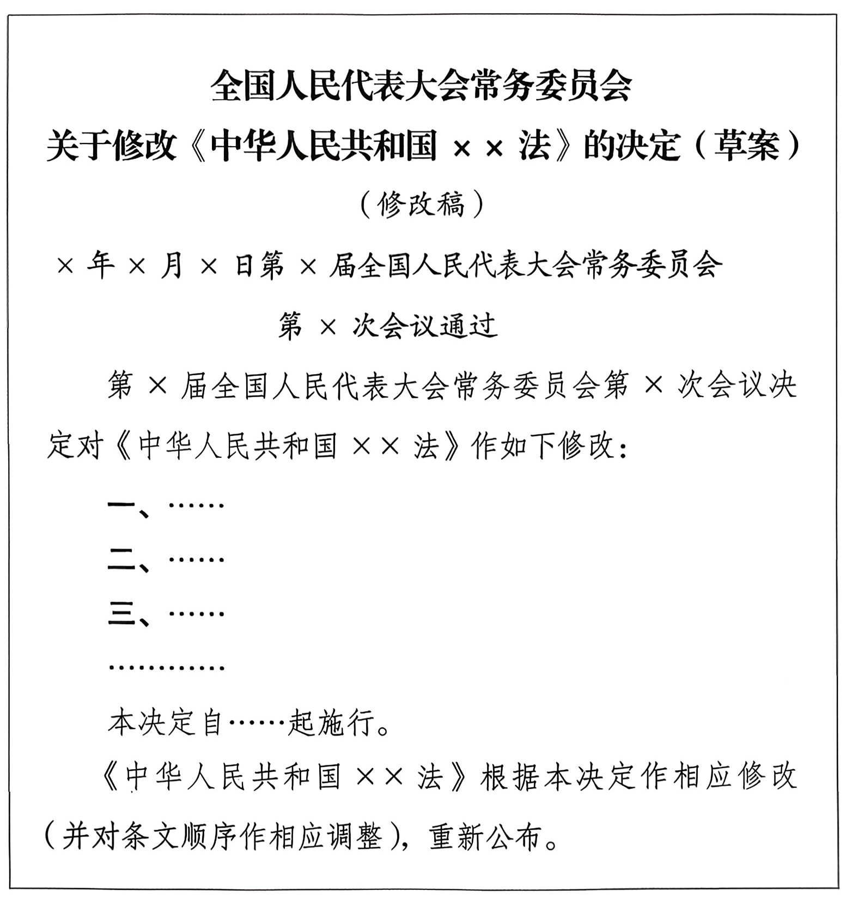

```
　　　　全国人民代表大会常务委员会
关于修改《中华人民共和国××法）的决定（草案）
　　　　　　　（修改稿）

　×年×月×日第×届全国人民代表大会常务委员会
　　　　　　第×次会议通过

第×届全国人民代表大会常务委员会第×次会议决
定对《中华人民共和国××法》作如下修改：
一、……
二、……
三、……
…………
本决定自……起施行。
《中华人民共和国××法》根据本决定作相应修改
（并对条文顺序作相应调整），重新公布。
```

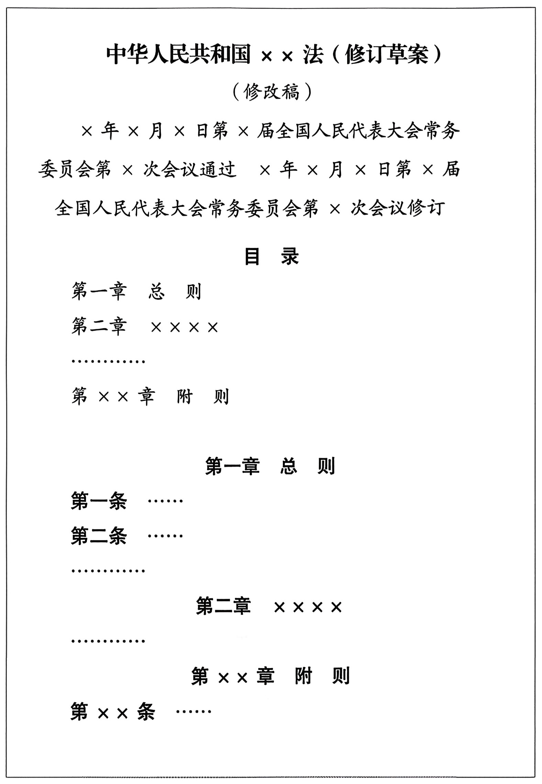

```
　　中华人民共和国××法（修订草案）
　　　　　（修改稿）

×年×月×日第×届全国人民代表大会常务
委员会第×次会议通过　×年×月×日第×届
全国人民代表大会常务委员会第×次会议修订

　　　　目　　录

第一章　总　则
第二章　××××
…………
第××章　附　则

　　　　第一章　总　则
第一条　……
第二条　……
…………

　　　　第二章　××××

…………

　　　　第××章　附则

第××条　……
```

> **注：** 法律多次修改的，在题注中按照时间顺序依次载明修改机关、修改日期、修改形式，修订和修正分别计次

#### 3.5 法律草案表决稿

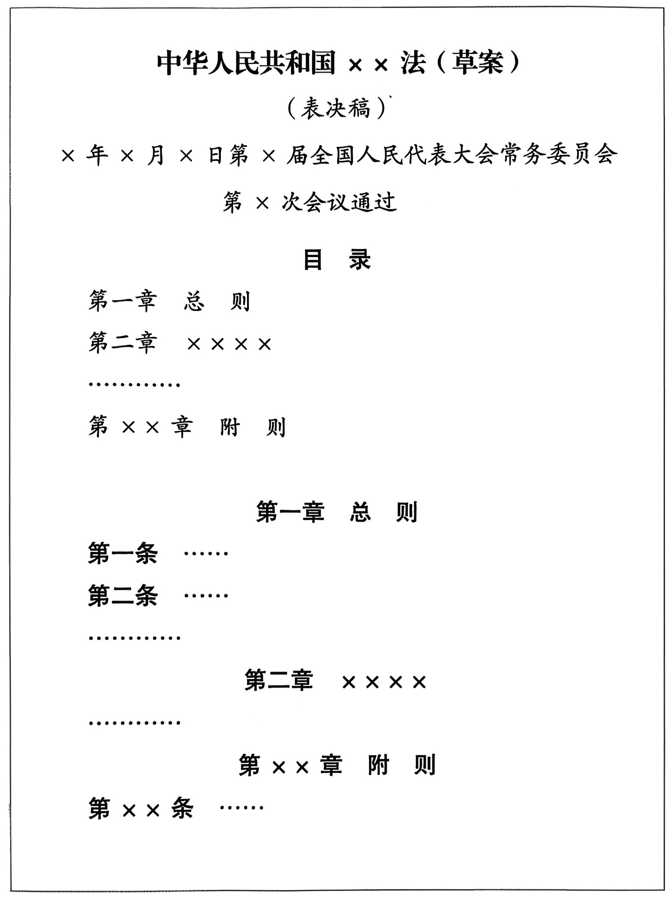

```
　　中华人民共和国××法（草案）
　　　　　（表决稿）

×年×月×日第×届全国人民代表大会常务委员会
　　　第×次会议通过

　　　　目　　录

第一章　总　则
第二章　××××
…………
第××章　附　则

　　　　第一章　总　则
第一条　……
第二条　……
…………

　　　　第二章　××××

…………

　　　　第××章　附则

第××条　……
```

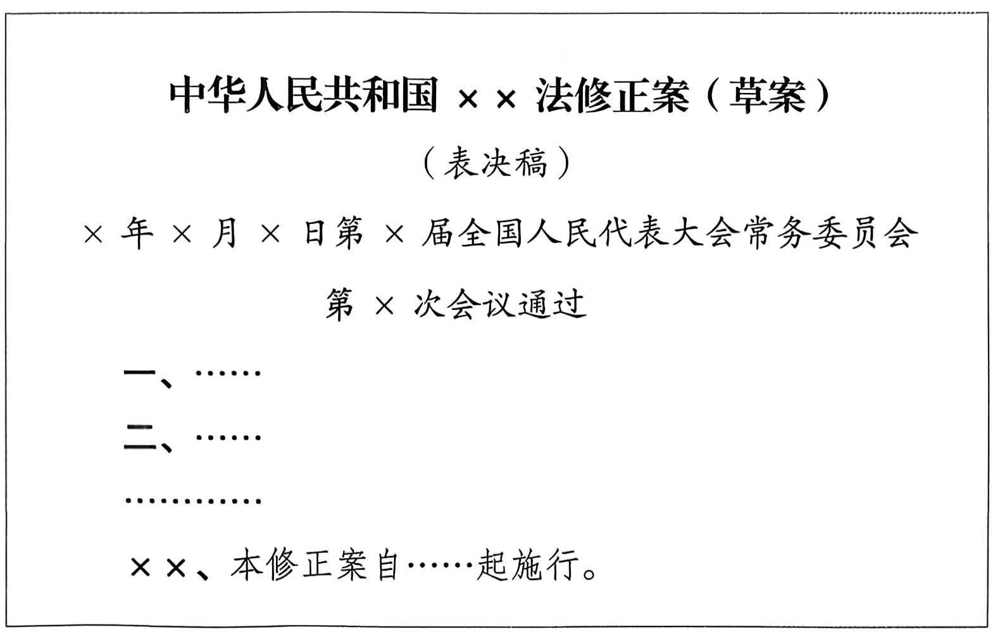

```
　　中华人民共和国××法修正案（草案）
　　　　　（表决稿）

×年×月×日第×届全国人民代表大会常务委员会
　　　第×次会议通过

一、……
二、……
…………
××、本修正案自……起施行。
```

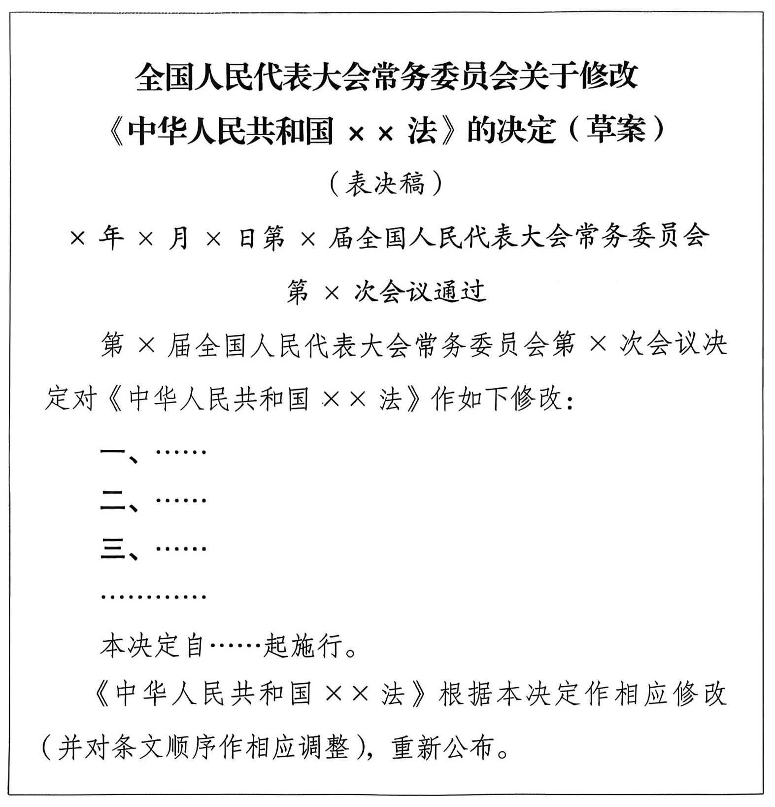

```
　　全国人民代表大会常务委员会关于修改
　《中华人民共和国××法》的决定（草案）
　　　　（表决稿）

×年×月×日第×届全国人民代表大会常务委员会
　　　　第×次会议通过

第×届全国人民代表大会常务委员会第×次会议决
定对《中华人民共和国××法》作如下修改：
一、……
二、……
三、……
…………
本决定自……起施行。
《中华人民共和国××法》根据本决定作相应修改
（并对条文顺序作相应调整），重新公布。
```

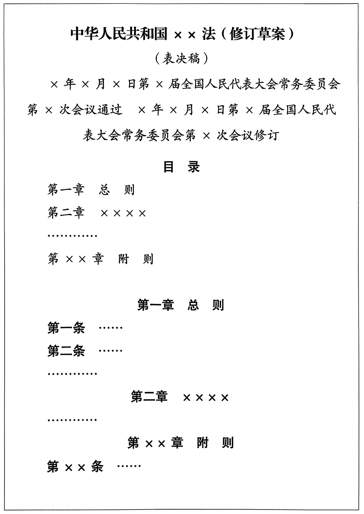

```
　　中华人民共和国××法（修订草案）
　　　　（表决稿）

×年×月×日第×届全国人民代表大会常务委员会
第×次会议通过　×年×月×日第×届全国人民代
　　表大会常务委员会第×次会议修订

　　　　目　　录

第一章　总　则
第二章　××××
…………
第××章　附　则

　　　　第一章　总　则
第一条　……
第二条　……
…………

　　　　第二章　××××

…………

　　　　第××章　附则

第××条　……
```

> **注：** 法律多次修改的，在题注中按照时间顺序依次载明修改机关、修改日期、修改形式，修订和修正分别计次

### 4. 主席令和公布的法律文本

#### 4.1 主席令

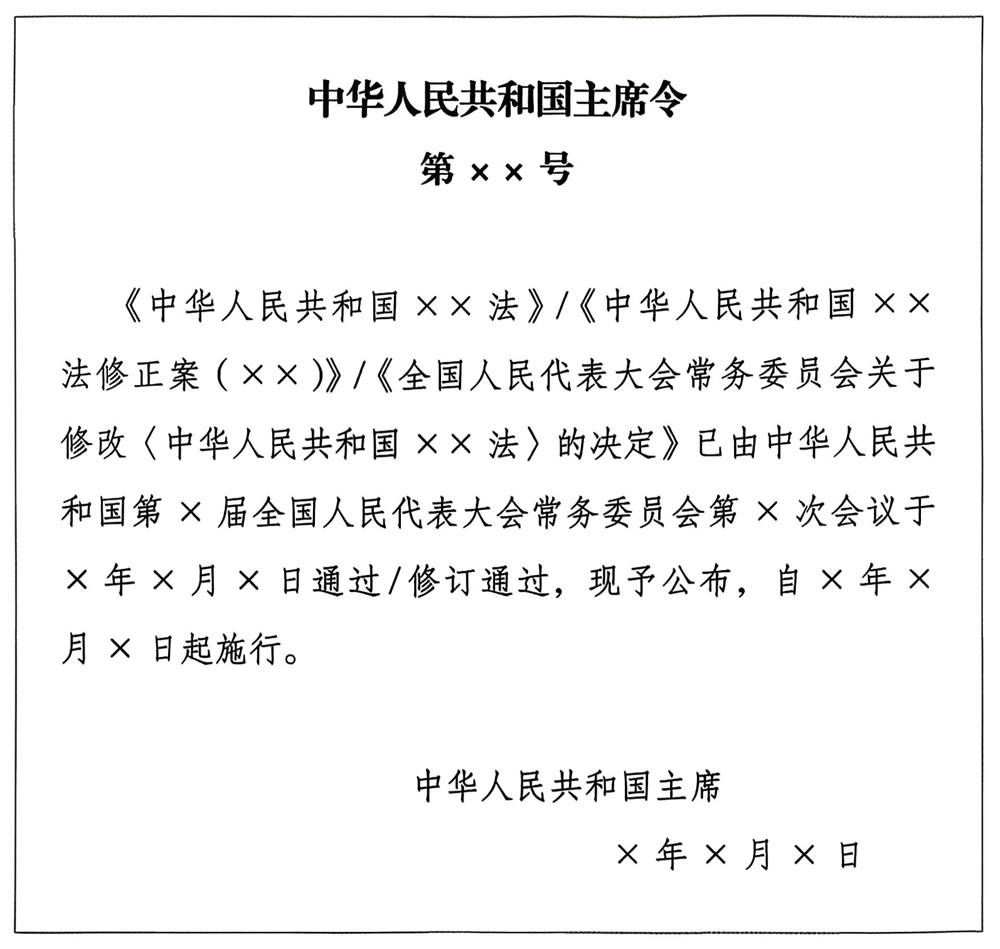

```
　　　　　　中华人民共和国主席令
　　　　　　　　　第××号

　　《中华人民共和国××法》/《中华人民共和国××
法修正案（××）》/《全国人民代表大会常务委员会关于
修改（中华人民共和国××法〉的决定》已由中华人民共
和国第×届全国人民代表大会常务委员会第×次会议于
×年×月×日通过/修订通过，现予公布，自×年×
月×日起施行。

　　　　　　　　　　中华人民共和国主席
　　　　　　　　　　　　　　　　　×年×月×日
```

> **注：** 主席令序号为中文数字

#### 4.2 法律

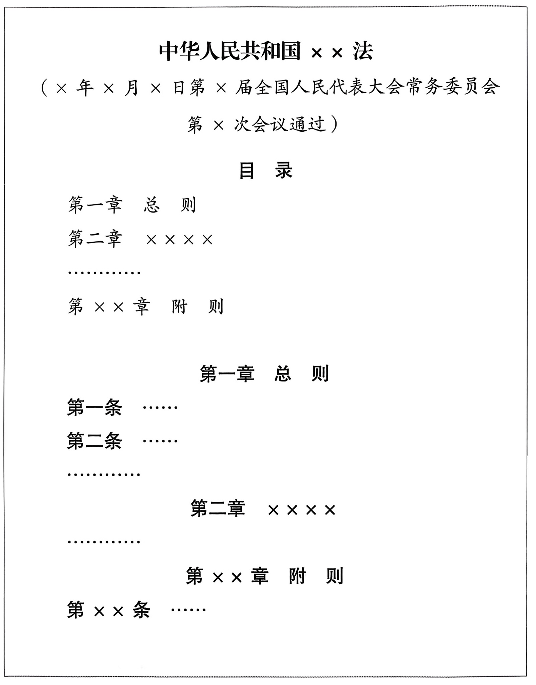

```
　　　　中华人民共和国××法
（×年×月×日第×届全国人民代表大会常务委员会
　　　　第×次会议通过）

　　　　目　　录

第一章　总　则
第二章　××××
…………
第××章　附　则

　　　　第一章　总　则
第一条　……
第二条　……
…………

　　　　第二章　××××

…………

　　　　第××章　附则

第××条　……
```

#### 4.3 修正案

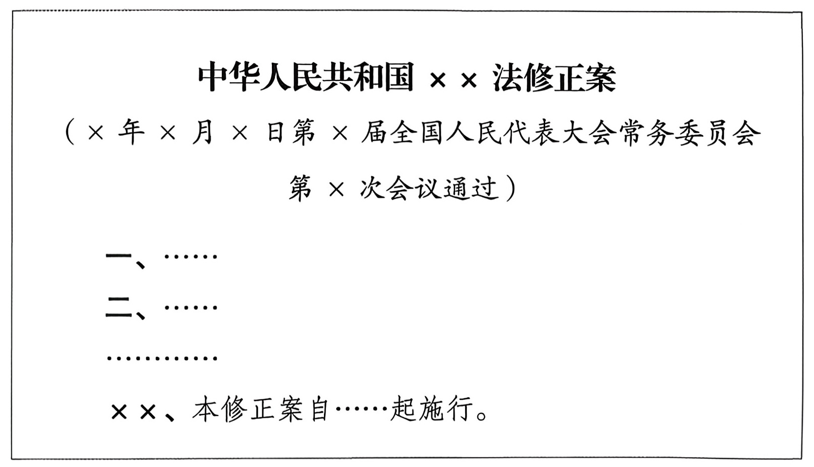

```
　　　　中华人民共和国××法修正案
（×年×月×日第×届全国人民代表大会常务委员会
　　　　　　第×次会议通过）

一、……
二、……
…………
××、本修正案自……起施行。
```

#### 4.4 修改法律的决定

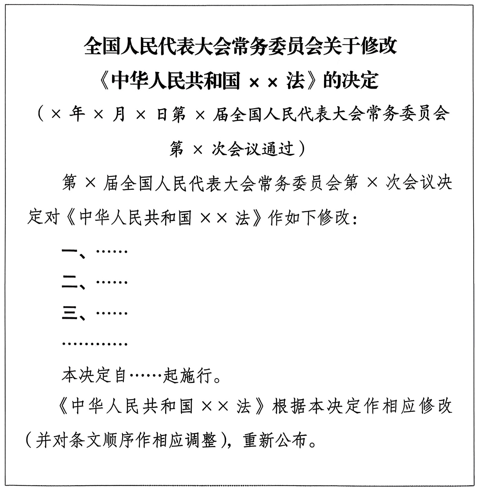

```
　　全国人民代表大会常务委员会关于修改
　　　《中华人民共和国××法〉的决定
（×年×月×日第×届全国人民代表大会常务委员会
　　　　　　第×次会议通过）

第×届全国人民代表大会常务委员会第×次会议决
定对《中华人民共和国××法》作如下修改：

一、……
二、……
三、……
…………
本决定自……起施行。
《中华人民共和国××法》根据本决定作相应修改
（并对条文顺序作相应调整），重新公布。
```

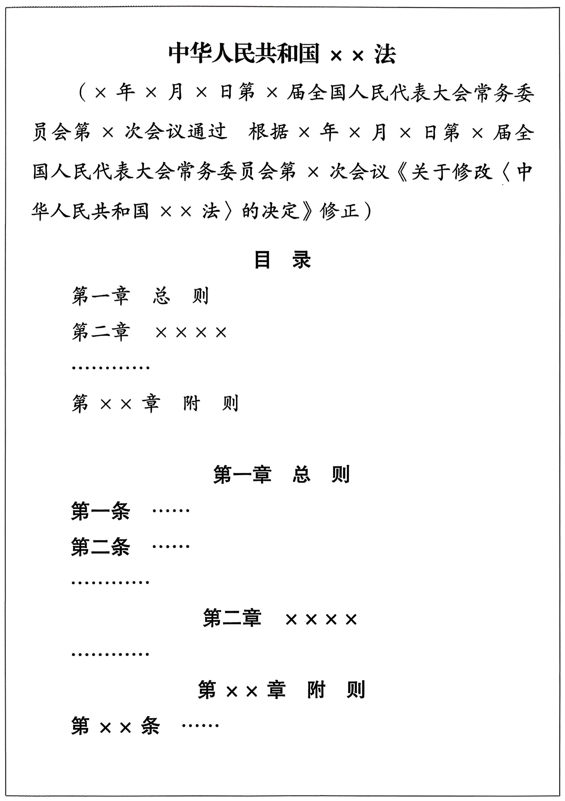

```
　　　　中华人民共和国××法
（×年×月×日第×届全国人民代表大会常务委
员会第×次会议通过根据×年×月×日第×届全
国人民代表大会常务委员会第×次会议《关于修改〈中
华人民共和国××法〉的决定》修正）

　　　　目　　录

第一章　总　则
第二章　××××
…………
第××章　附　则

　　　　第一章　总　则
第一条　……
第二条　……
…………

　　　　第二章　××××

…………

　　　　第××章　附则

第××条　……
```

> **注：** 法律多次修改的，在题注中按照时间顺序依次载明修改机关、修改日期、修改形式，修订和修正分别计次

#### 4.5 修订后的法律

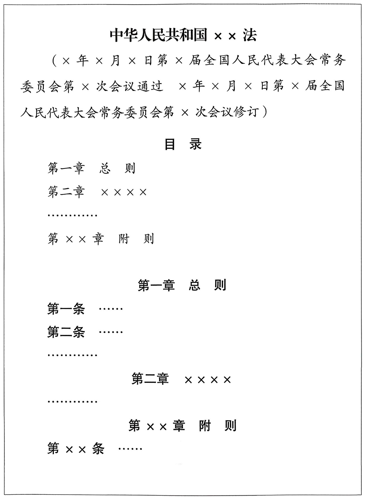

```
　　　　中华人民共和国××法
（×年×月×日第×届全国人民代表大会常务
委员会第×次会议通过×年×月×日第×届全国
人民代表大会常务委员会第×次会议修订）

　　　　目　　录

第一章　总　则
第二章　××××
…………
第××章　附　则

　　　　第一章　总　则
第一条　……
第二条　……
…………

　　　　第二章　××××

…………

　　　　第××章　附则

第××条　……
```

> **注：** 法律多次修改的，在题注中按照时间顺序依次载明修改机关、修改日期、修改形式，修订和修正分别计次

---

## 附录

中华人民共和国立法法（略）
